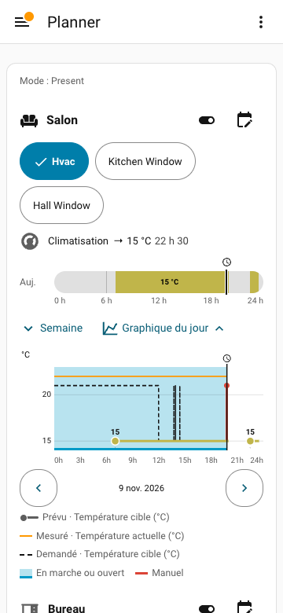
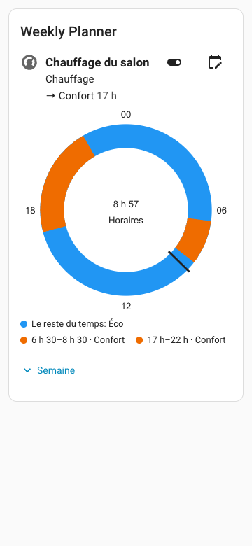

# Weekly Planner

[English](https://github.com/movrack/ha_weekly_planner/blob/main/README.md) | Français

[](https://hacs.xyz)
[](https://github.com/movrack/ha_weekly_planner/releases/latest)
[](https://github.com/movrack/ha_weekly_planner/actions/workflows/validate.yml)
[](https://github.com/movrack/ha_weekly_planner/blob/main/LICENSE)
[-cd7f32.svg)](https://github.com/movrack/ha_weekly_planner/blob/main/custom_components/weekly_planner/quality_scale.yaml)

Un planificateur hebdomadaire pour Home Assistant, avec sa propre carte de tableau de bord. Donnez à
chaque appareil une semaine d’horaires (volets, chauffage, lumières, ou tout ce qu’une action ou une
scène Home Assistant peut commander) et voyez sur une seule carte ce qui est prévu et ce qui s’est passé.




Niveau de qualité : Bronze auto-déclaré sur l’échelle de qualité des intégrations Home Assistant (intégration personnalisée, sans badge officiel) ; voir [`quality_scale.yaml`](https://github.com/movrack/ha_weekly_planner/blob/main/custom_components/weekly_planner/quality_scale.yaml).

Ce projet a été réalisé avec l’aide d’agents d’intelligence artificielle.

## Ce que ça fait

- **Une semaine par appareil** : des horaires avec un début, une fin facultative et les jours concernés.
- **Des réglages partagés** : un réglage se nomme une fois (« Confort », « Fermé ») avec son action ou sa
  scène Home Assistant, et sert dans tous les programmes.
- **Le reste du temps** : un réglage par défaut facultatif pour chaque appareil, en dehors de ses horaires.
- **Soleil et délai aléatoire** : début ou fin au lever ou au coucher du soleil, avec un décalage, une
  heure au plus tôt et au plus tard, et un délai aléatoire facultatif.
- **Modes** : une semaine d’horaires par mode de la maison (Présent, Absent, Vacances…), lu sur une
  entité sélecteur que vous choisissez.
- **Jour férié** : une autre journée d’horaires un jour férié ou de congé, lu sur une entité que vous choisissez.
- **Une carte, cinq affichages** : barres, liste compacte, cadran 24 h, cadrans 12 h ou horaires du jour,
  avec un graphique du jour qui compare ce qui est prévu et l’historique enregistré.
- **Commandes de tous les jours** : sauter le prochain changement, mettre un programme en pause pour des
  heures ou des jours, suspendre tous les programmes, resynchroniser les appareils après une panne.
- **Configuration en texte** : un fichier YAML reflète les programmes et peut être modifié à la main.

## Cas d’usage

- **Volets** : ouvrir au lever du soleil mais pas avant 7 h, fermer au coucher du soleil.
- **Chauffage** : une température de confort le matin et le soir, plus basse le reste du temps, et une
  autre semaine quand la maison est en mode Absent.
- **Tout le reste** : lumières, interrupteurs, scènes, ou activer et désactiver une automatisation.

## Appareils compatibles

Il n’y a pas de catalogue de marques ou d’appareils. Weekly Planner fonctionne avec les entités Home
Assistant existantes : il lit dans Home Assistant les actions que chaque entité accepte, leurs champs
et les attributs de l’entité, et vous choisissez les actions qu’un programme peut utiliser. Les scènes
sont prises en charge aussi.

## Prérequis

- Home Assistant **2026.10.0 ou ultérieur**.
- [HACS](https://hacs.xyz), ou un accès au dossier de configuration de Home Assistant pour une installation à la main.
- L’historique de Home Assistant (Recorder) pour la partie enregistrée du graphique. La planification fonctionne sans lui.

## Installation

### Avec HACS

[](https://my.home-assistant.io/redirect/hacs_repository/?owner=movrack&repository=ha_weekly_planner&category=integration)

1. Utiliser le bouton ci-dessus, ou ajouter `https://github.com/movrack/ha_weekly_planner` dans HACS
   comme dépôt personnalisé de catégorie **Intégration**.
2. Installer **Weekly Planner**.
3. Redémarrer Home Assistant pour charger son code Python.

### À la main

1. Télécharger la [dernière version](https://github.com/movrack/ha_weekly_planner/releases/latest).
2. Copier son dossier `custom_components/weekly_planner` dans le dossier `custom_components` de votre
   configuration Home Assistant.
3. Redémarrer Home Assistant.

### Ajouter l’intégration

[](https://my.home-assistant.io/redirect/config_flow_start/?domain=weekly_planner)

Utiliser le bouton ci-dessus, ou ouvrir **Paramètres → Appareils et services → Ajouter une intégration →
Weekly Planner**. Rien n’est demandé à cette étape. Une seule instance de l’intégration contient tous
les programmes. Ne pas en ajouter une autre pour créer un autre programme.

### Ajouter la carte

Ajouter une carte **Weekly Planner** à un tableau de bord. Aucun second dépôt de carte n’est
nécessaire : en mode Lovelace storage, l’intégration enregistre et met à jour son module JavaScript
toute seule ; en mode YAML, elle le charge par le mécanisme des modules JavaScript supplémentaires de
Home Assistant.

## Premier programme

1. Modifier le tableau de bord et ouvrir l’éditeur de la carte **Weekly Planner**.
2. Sous **Réglages des programmes**, choisir **Nouveau programme** (administrateurs seulement).
3. Nommer le programme, ajouter ses appareils et choisir les actions proposées pour chaque appareil.
4. **Appliquer au programme** enregistre tout de suite, pour toutes les cartes qui montrent ce programme.
5. **Définir les horaires** ouvre les horaires du programme. Ajouter un horaire : les jours, les heures
   de début et de fin, puis le réglage.

Le [guide illustré](https://github.com/movrack/ha_weekly_planner/wiki/Guide-utilisateur) montre chaque
étape avec des captures d’écran.

## Configuration

### Options de l’intégration

**Paramètres → Appareils et services → Weekly Planner → Configurer** :

| Option | Défaut | Effet |
|---|---|---|
| Seuls les administrateurs peuvent modifier les programmes | non | Réserve aux administrateurs les modifications des programmes et des réglages. |
| Refaire le réglage en cours après un redémarrage ou une modification | oui | Valeur de départ de **Réappliquer** pour chaque nouveau programme. |
| Alerte si un appareil est indisponible depuis | 30 min | Délai avant la notification, de 1 à 1440 minutes. |
| Attendre avant d’appliquer un changement de condition | 2 min | Délai de stabilité des conditions du programme, de 0 à 60 minutes. |
| Sélecteur de mode (facultatif) | aucun | Une entité `input_select` ou `select` dont l’état est le mode de la maison ; un mode par défaut est demandé ensuite. |
| Jour férié ou congé (facultatif) | aucun | Une entité `binary_sensor`, `input_boolean`, `switch` ou `calendar` qui dit si aujourd’hui est un jour férié. |
| Cette entité est allumée les jours travaillés, pas les jours fériés | non | À cocher seulement pour une entité allumée les jours travaillés, comme un capteur Workday. |

Le mode a priorité sur le jour férié, qui ne s’applique qu’au mode en cours. Les options proposent
aussi **Resynchroniser les appareils** (administrateurs seulement) : la liste de ce qui serait envoyé
s’affiche, et rien n’est envoyé avant votre confirmation.
Détails : [permissions et options](https://github.com/movrack/ha_weekly_planner/blob/main/wiki/REFERENCE.fr.md#permissions-et-options),
[modes](https://github.com/movrack/ha_weekly_planner/blob/main/wiki/REFERENCE.fr.md#modes-et-sélecteur-de-mode),
[jour férié](https://github.com/movrack/ha_weekly_planner/blob/main/wiki/REFERENCE.fr.md#jour-férié).

### Options de la carte

Chaque option se règle dans l’éditeur visuel ou en YAML. Les principales :

| Option | Effet |
|---|---|
| `program` | Affiche un seul programme (son identifiant ou son nom). |
| `filter` | Sans `program` : garde les programmes selon `types`, `area` ou `programs`. Sans filtre, tous les programmes sont affichés. |
| `schedule_view` | `bars` (par défaut), `list`, `radial`, `radial_12h` ou `times`. |
| `sort`, `order` | Ordre de la liste : par `type` (par défaut), `area`, `name`, ou votre propre ordre. |
| `show_chart`, `chart_collapsed` | Bouton du graphique sous chaque appareil, et graphique fermé ou ouvert au départ. |
| `title` | Titre de la carte. |

Tableau complet et types YAML : [options de la carte](https://github.com/movrack/ha_weekly_planner/blob/main/wiki/REFERENCE.fr.md#configuration-de-la-carte).

## Entités et actions

L’intégration crée un interrupteur global de suspension, et un interrupteur
par programme. Il n’y a pas de `select` de mode : le mode vient de votre sélecteur. Inspecter le registre réel : ne pas supposer
un identifiant anglais généré sur une autre installation.

| Entité | Comportement |
|---|---|
| Interrupteur de programme | Active ou suspend. Attributs : `program_id`, `no_schedule_for_mode`, `current_slots`, `next_change`, `skip_next`, `skip_next_targets`, `next_actions` et, selon le cas, `paused_until`, `verification` et `holiday` (le jour férié remplace le jour de la semaine : `{copy: 0..6}` ou `{own: true}`). Il n’y a pas d’attribut du mode actif : le mode se lit sur l’entité sélecteur. |
| Interrupteur global | Suspend les programmes et applique une fois les défauts éligibles. |

| Action | Champs | Qui peut l’appeler |
|---|---|---|
| `weekly_planner.apply_now` | `program_id` (obligatoire) ; renvoie `sent` et `skipped` (avec la raison) ; renvoie aussi le dernier ponctuel de moins de 24 h sauf intervention d'une personne depuis | Tout le monde ; administrateurs seulement si `admin_only` est actif |
| `weekly_planner.skip_next` | `program_id` (obligatoire), `cancel` (facultatif, `false` par défaut) | Comme `apply_now` |
| `weekly_planner.pause` | `program_id` (obligatoire), `days` et/ou `hours` (entiers, au moins un ; de 1 heure à 365 jours au total) | Comme `apply_now` |
| `weekly_planner.resume` | `program_id` (obligatoire) ; annule seulement une pause temporisée (un programme arrêté avec son interrupteur reste arrêté) | Comme `apply_now` |
| `weekly_planner.reload` | aucun | Administrateurs |

`program_id` est l’attribut `program_id` de l’interrupteur du programme.

```yaml
# Réappliquer l’action voulue maintenant
action: weekly_planner.apply_now
data:
  program_id: YOUR_PROGRAM_ID
```

```yaml
# Sauter le prochain changement une fois ; cancel: true annule le saut
action: weekly_planner.skip_next
data:
  program_id: YOUR_PROGRAM_ID
```

```yaml
# Mettre un programme en pause de 1 heure à 365 jours (`days`, `hours` ou les deux) ; il reprend tout seul (même après un redémarrage)
action: weekly_planner.pause
data:
  program_id: YOUR_PROGRAM_ID
  days: 7
```

```yaml
# Reprendre tout de suite un programme en pause
action: weekly_planner.resume
data:
  program_id: YOUR_PROGRAM_ID
```

```yaml
# Recharger l’intégration et enregistrer le bundle courant
action: weekly_planner.reload
```

Les interrupteurs utilisent `switch.turn_on` et `switch.turn_off`. Planifier
`automation.turn_on` active les déclencheurs d’une automatisation ; ce n’est pas
`automation.trigger`.

## Exemples

Un programme avec un cadran de 24 heures :

```yaml
type: custom:weekly-planner-card
program: YOUR_PROGRAM_ID
title: Salon
schedule_view: radial
```

La journée d’aujourd’hui en liste d’horaires :

```yaml
type: custom:weekly-planner-card
program: YOUR_PROGRAM_ID
schedule_view: times
```

Plusieurs programmes en liste compacte :

```yaml
type: custom:weekly-planner-card
title: Horaires
schedule_view: list
filter:
  types:
    - climate
    - cover
```

Passer la maison en mode Absent (utiliser votre sélecteur et le nom exact d’une option) :

```yaml
action: input_select.select_option
target:
  entity_id: input_select.house_mode
data:
  option: Absent
```

D’autres exemples : [recettes pour les modes](https://github.com/movrack/ha_weekly_planner/wiki/Recettes-pour-les-modes)
et [actions des réglages](https://github.com/movrack/ha_weekly_planner/wiki/Actions-generiques).

## Fonctionnement

Tout est calculé localement dans Home Assistant ; aucun appareil n’est interrogé et aucun service
cloud n’est utilisé. Le moteur calcule ce que chaque appareil doit faire et agit quand cela change :
au début et à la fin d’un horaire, à un changement de mode ou de jour férié et, quand **Réappliquer**
est actif, après un redémarrage ou une modification. Il ne force pas l’état d’un appareil en continu
et n’annule pas un changement fait à la main. La carte reçoit les mises à jour en direct de l’intégration.

## Mise à jour

Sauvegarder d’abord Home Assistant (les programmes sont dans `.storage`). Mettre à jour Weekly Planner
dans HACS, puis redémarrer Home Assistant. Une carte ouverte se recharge toute seule, une fois au
repos, quand son fichier a changé.

## Limites connues

- Un changement fait à la main sur un appareil n’est ni détecté ni annulé ; il peut apparaître sur le graphique.
- Un horaire sans fin est envoyé une fois et n’est pas rejoué une fois son heure passée.
- Le filtre Pièce de la carte vise la pièce donnée au programme, pas les pièces Home Assistant de ses appareils.
- Le formulaire ne propose pas de conditions par horaire ; les conditions se règlent pour tout le programme.
- La partie enregistrée du graphique dépend de l’historique de Home Assistant.
- `/config/www/weekly_planner.yml` est servi **sans authentification** à l’adresse
  `http://<votre-ha>/local/weekly_planner.yml`. Les horaires, jours fériés compris, révèlent quand la
  maison est occupée ou vide. N’exposez pas cette adresse sur Internet (reverse proxy, redirection de port).

Limites de validation et détails : [limites et diagnostic](https://github.com/movrack/ha_weekly_planner/blob/main/wiki/REFERENCE.fr.md#limites-et-diagnostic).

## Dépannage

- **La carte n’affiche aucun programme** : vérifier ses filtres et l’identifiant du programme.
- **Une action manque dans un réglage** : vérifier les actions choisies pour l’appareil dans **Réglages
  des programmes → Appareils**, les fonctions que l’entité prend en charge et ses attributs.
- **Un appareil n’a pas bougé** : regarder les attributs de l’interrupteur du programme, les
  **Réparations**, les notifications et les journaux de Home Assistant. Weekly Planner vous prévient
  quand une entité reste indisponible alors qu’une action attend, et quand une action n’a pas pu être exécutée.
- **Le fichier de configuration est refusé** : une réparation affiche l’erreur ; rien ne change tant que
  le fichier n’est pas valide.

Pour signaler un bug, ouvrir une [issue](https://github.com/movrack/ha_weekly_planner/issues) avec la
version de Home Assistant, la version de Weekly Planner et les lignes de journal concernées.

## Désinstallation

1. Ouvrir **Paramètres → Appareils et services → Weekly Planner**, puis le menu à trois points → **Supprimer**.
   Cela retire les interrupteurs et efface les programmes enregistrés ainsi que le
   fichier `/config/www/weekly_planner.yml` (et ses restes `.invalid` et `.tmp`).
2. Retirer la carte **Weekly Planner** de chaque tableau de bord (modifier le tableau de bord, ouvrir la carte, la supprimer).
   Sans l’intégration, la carte n’affiche plus rien d’utile.
3. Dans **HACS → Intégrations → Weekly Planner → ⋮ → Supprimer**, puis redémarrer Home Assistant.

Où sont les données, pour vérifier ou nettoyer à la main (Home Assistant arrêté, ou intégration retirée du
disque avant son entrée) : les programmes sont dans `/config/.storage/weekly_planner` (avec `weekly_planner.runtime` et `weekly_planner.journal`) et le miroir YAML dans
`/config/www/weekly_planner.yml`. Supprimer ces fichiers ne laisse rien. Les sauvegarder d’abord si une
réinstallation est possible : les remettre en place rétablit les programmes.

## Documentation

- [Guide illustré](https://github.com/movrack/ha_weekly_planner/wiki/Guide-utilisateur) et
  [atlas des écrans](https://github.com/movrack/ha_weekly_planner/wiki/Atlas-des-ecrans).
- [Modes](https://github.com/movrack/ha_weekly_planner/wiki/Modes).
- [Référence pour intégrateurs](https://github.com/movrack/ha_weekly_planner/blob/main/wiki/REFERENCE.fr.md) :
  options de la carte, modèle et exécution, modes et jour férié, permissions, stockage et API, fichier YAML, limites.
- Pour les agents IA : une version installée contient [`AI_GUIDE.md`](https://github.com/movrack/ha_weekly_planner/blob/main/custom_components/weekly_planner/AI_GUIDE.md)
  et un [`example.yml`](https://github.com/movrack/ha_weekly_planner/blob/main/custom_components/weekly_planner/example.yml) annoté ;
  [`llms.txt`](https://github.com/movrack/ha_weekly_planner/blob/main/llms.txt) les indexe.
- [Journal des modifications](https://github.com/movrack/ha_weekly_planner/blob/main/CHANGELOG.md).

## Contribuer

Voir [CONTRIBUTING.md](https://github.com/movrack/ha_weekly_planner/blob/main/CONTRIBUTING.md) (en anglais).
Les questions et les idées sont les bienvenues dans les [issues](https://github.com/movrack/ha_weekly_planner/issues).

## Licence

[MIT](https://github.com/movrack/ha_weekly_planner/blob/main/LICENSE)
