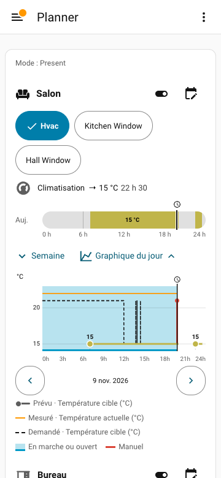
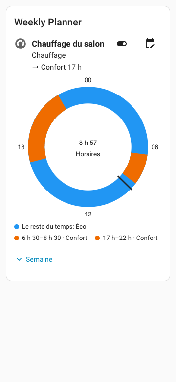

# Weekly Planner

English | [Français](https://github.com/movrack/ha_weekly_planner/blob/main/README.fr.md)

[](https://hacs.xyz)
[](https://github.com/movrack/ha_weekly_planner/releases/latest)
[](https://github.com/movrack/ha_weekly_planner/actions/workflows/validate.yml)
[](https://github.com/movrack/ha_weekly_planner/blob/main/LICENSE)
[-cd7f32.svg)](https://github.com/movrack/ha_weekly_planner/blob/main/custom_components/weekly_planner/quality_scale.yaml)

A weekly scheduler for Home Assistant with its own dashboard card. Give each device a week of
schedules (shutters, heating, lights, or anything a Home Assistant action or scene can drive) and see
on one card what is planned and what happened.




Quality level: self-declared Bronze on the Home Assistant Integration Quality Scale (custom integration, no official badge); see [`quality_scale.yaml`](https://github.com/movrack/ha_weekly_planner/blob/main/custom_components/weekly_planner/quality_scale.yaml).

This project was developed with the assistance of AI agents.

## What it does

- **A week for each device**: schedules with a start, an optional end and the days they apply to.
- **Shared settings**: name a setting once (“Comfort”, “Closed”) with its Home Assistant action or
  scene, and reuse it in every program.
- **The rest of the time**: an optional default setting for each device outside its schedules.
- **Sun and random delay**: start or end at sunrise or sunset, with an offset, earliest and latest
  limits, and an optional random delay.
- **Modes**: one week of schedules per mode of the house (Home, Away, Vacation…), read from a selector
  entity that you choose.
- **Day off**: another day of schedules on a holiday or day off, read from an entity that you choose.
- **One card, five views**: bars, compact list, 24-hour dial, 12-hour dials, or today’s times, with a
  chart of the day that compares the plan with the recorded history.
- **Everyday controls**: skip the next change, pause a program for hours or days, suspend all programs,
  resynchronise the devices after an outage.
- **Text configuration**: a YAML file mirrors the programs and can be edited by hand.

## Use cases

- **Shutters and covers**: open at sunrise but not before 07:00, close at sunset.
- **Heating**: a comfort temperature in the morning and evening, a lower one the rest of the time, and
  another week when the house is in Away mode.
- **Anything else**: lights, switches, scenes, or turning an automation on and off.

## Supported devices

There is no catalogue of brands or devices. Weekly Planner works with existing Home Assistant entities:
it reads the actions each entity accepts, their fields and the entity attributes from Home Assistant,
and you choose which actions a program may use. Scenes are supported as well.

## Requirements

- Home Assistant **2026.10.0 or later**.
- [HACS](https://hacs.xyz), or access to the Home Assistant configuration folder for a manual install.
- The Home Assistant history (Recorder) for the recorded part of the chart. Scheduling works without it.

## Installation

### With HACS

[](https://my.home-assistant.io/redirect/hacs_repository/?owner=movrack&repository=ha_weekly_planner&category=integration)

1. Use the button above, or add `https://github.com/movrack/ha_weekly_planner` in HACS as a custom
   **Integration** repository.
2. Install **Weekly Planner**.
3. Restart Home Assistant to load its Python code.

### Manually

1. Download the [latest release](https://github.com/movrack/ha_weekly_planner/releases/latest).
2. Copy its `custom_components/weekly_planner` folder into the `custom_components` folder of your
   Home Assistant configuration.
3. Restart Home Assistant.

### Add the integration

[](https://my.home-assistant.io/redirect/config_flow_start/?domain=weekly_planner)

Use the button above, or open **Settings → Devices & services → Add integration → Weekly Planner**.
Nothing is asked at this step. There is one integration entry per Home Assistant instance; it owns
every program. Do not add another entry to create another program.

### Add the card

Add a **Weekly Planner** card to a dashboard. There is no separate card repository: in Lovelace storage
mode the integration registers and updates its JavaScript module by itself; in YAML resource mode it
loads the module through Home Assistant’s extra-JavaScript mechanism.

## First program

1. Edit the dashboard and open the **Weekly Planner** card editor.
2. Under **Program settings**, choose **New program** (administrators only).
3. Name the program, add its devices and choose the actions offered for each device.
4. **Apply to program** saves it at once, for every card that shows this program.
5. **Set schedules** opens the schedules of the program. Add a schedule: the days, the start and end times, then the setting.

The [illustrated guide](https://github.com/movrack/ha_weekly_planner/wiki/Guide-utilisateur) (in French)
shows every step with screenshots.

## Configuration

### Integration options

**Settings → Devices & services → Weekly Planner → Configure**:

| Option | Default | What it does |
|---|---|---|
| Only administrators can edit programs | off | Reserves program and setting changes to administrators. |
| Send the current setting again after a restart or a change | on | Starting value of the **Re-apply the current setting after a restart or a change** box for every new program. |
| Alert when a device has been unavailable for | 30 min | Delay before the notification, 1 to 1440 minutes. |
| Wait before applying a change of condition | 2 min | Stability delay of the program conditions, 0 to 60 minutes. |
| Mode selector (optional) | none | An `input_select` or `select` entity whose state is the mode of the house; a default mode is asked next. |
| Holiday or day off (optional) | none | A `binary_sensor`, `input_boolean`, `switch` or `calendar` entity that says whether today is a day off. |
| This entity is on during working days, not on days off | off | Tick it only for an entity that is on on working days, such as a Workday sensor. |

The mode has priority over the day off, which only applies to the current mode. The options also offer
**Resynchronise the devices** (administrators only): it lists what would be sent and sends nothing
before you confirm.
Details: [permissions and options](https://github.com/movrack/ha_weekly_planner/blob/main/wiki/REFERENCE.md#permissions-and-integration-options),
[modes](https://github.com/movrack/ha_weekly_planner/blob/main/wiki/REFERENCE.md#modes-and-the-mode-selector),
[day off](https://github.com/movrack/ha_weekly_planner/blob/main/wiki/REFERENCE.md#day-off).

### Card options

Every option can be set in the visual editor or in YAML. The main ones:

| Option | What it does |
|---|---|
| `program` | Shows one program (its ID or its name). |
| `filter` | Without `program`: keeps programs by `types`, `area` or `programs`. No filter shows every program. |
| `schedule_view` | `bars` (default), `list`, `radial`, `radial_12h` or `times`. |
| `sort`, `order` | Order of the list: by `type` (default), `area`, `name`, or your own order. |
| `show_chart`, `chart_collapsed` | Chart button under each device, and whether the chart starts closed. |
| `title` | Card title. |

Full table and YAML types: [card options](https://github.com/movrack/ha_weekly_planner/blob/main/wiki/REFERENCE.md#dashboard-configuration).

## Entities and actions

The integration creates one global suspension switch, and one program switch per
program. There is no mode `select`: the mode comes from your selector. Inspect the actual entity registry;
do not assume a generated English entity ID on another installation.

| Entity | Integration behavior |
|---|---|
| Program `switch` | Turn the program on or off. Attributes: `program_id`, `no_schedule_for_mode`, `current_slots`, `next_change`, `skip_next`, `skip_next_targets`, `next_actions`, and when relevant `paused_until`, `verification` and `holiday` (today’s day off replaces the weekday: `{copy: 0..6}` or `{own: true}`). There is no active-mode attribute: read the mode on the selector entity. |
| Global suspension `switch` (all programs) | Suspend all programs and apply each device’s “rest of the time” setting once. |

| Action | Fields | Who can call it |
|---|---|---|
| `weekly_planner.apply_now` | `program_id` (required); returns `sent` and `skipped` (with the reason); also resends the last one-shot of less than 24 h unless a person changed the device since | Anyone; administrators only if `admin_only` is on |
| `weekly_planner.skip_next` | `program_id` (required), `cancel` (optional, default `false`) | Same as `apply_now` |
| `weekly_planner.pause` | `program_id` (required), `days` and/or `hours` (whole numbers, at least one; 1 hour to 365 days in total) | Same as `apply_now` |
| `weekly_planner.resume` | `program_id` (required); cancels a timed pause only (a program switched off with its switch stays off) | Same as `apply_now` |
| `weekly_planner.reload` | none | Administrators |

`program_id` is the `program_id` attribute of the program switch.

```yaml
# Reapply the program's current desired action now.
action: weekly_planner.apply_now
data:
  program_id: YOUR_PROGRAM_ID
```

```yaml
# Skip the next change once; use cancel: true to cancel a pending skip.
action: weekly_planner.skip_next
data:
  program_id: YOUR_PROGRAM_ID
```

```yaml
# Pause a program for 1 hour to 365 days (`days`, `hours`, or both); it resumes by itself (even after a restart).
action: weekly_planner.pause
data:
  program_id: YOUR_PROGRAM_ID
  days: 7
```

```yaml
# Resume a paused program now.
action: weekly_planner.resume
data:
  program_id: YOUR_PROGRAM_ID
```

```yaml
# Reload this integration and register the current card bundle.
action: weekly_planner.reload
```

The program and global switches use the usual `switch.turn_on` / `switch.turn_off`
actions. Enabling an `automation.*` entity with a scheduled `automation.turn_on`
action enables its triggers; it is not the same as `automation.trigger`.

## Examples

A single program with a 24-hour dial:

```yaml
type: custom:weekly-planner-card
program: YOUR_PROGRAM_ID
title: Living room
schedule_view: radial
```

Today as a list of times:

```yaml
type: custom:weekly-planner-card
program: YOUR_PROGRAM_ID
schedule_view: times
```

Several programs in a compact list:

```yaml
type: custom:weekly-planner-card
title: Schedules
schedule_view: list
filter:
  types:
    - climate
    - cover
```

Switch the house to the Away mode (use your selector entity and an exact option name):

```yaml
action: input_select.select_option
target:
  entity_id: input_select.house_mode
data:
  option: Away
```

More, in French: [mode recipes](https://github.com/movrack/ha_weekly_planner/wiki/Recettes-pour-les-modes)
and [setting actions](https://github.com/movrack/ha_weekly_planner/wiki/Actions-generiques).

## How it runs

Everything is computed locally in Home Assistant; no device is polled and no cloud service is used. The
engine works out what each device should be doing and acts when that changes: at the start and end of
a schedule, on a mode or day-off change and, when re-applying is on for the program, after a restart or an edit. It
does not keep enforcing the state of a device, and it does not undo a manual change. The card receives
live updates from the integration.

## Updating

Back up Home Assistant first (the programs are in `.storage`). Update Weekly Planner in HACS, then
restart Home Assistant. An open card reloads by itself once idle when its bundle has changed.

## Known limitations

- A manual change on a device is not detected or undone; it may be shown on the chart.
- A schedule that has no end is sent once and is not replayed after its time has passed.
- The room filter of the card matches the room given to a program, not the Home Assistant rooms of its devices.
- Schedules cannot have their own conditions in the form; conditions are set for the whole program.
- The recorded part of the chart depends on the Home Assistant history.
- `/config/www/weekly_planner.yml` is served **without authentication** at
  `http://<your-ha>/local/weekly_planner.yml`. The schedules, day-off times included, reveal when the
  house is occupied or empty. Do not expose this address to the internet (reverse proxy, port forwarding).

Validation limits and details: [known limits](https://github.com/movrack/ha_weekly_planner/blob/main/wiki/REFERENCE.md#known-ui-limits-and-diagnostics).

## Troubleshooting

- **The card shows no program**: check its filters and its program ID.
- **An action is missing in a setting**: check the actions chosen for the device in **Program settings →
  Devices**, the features the entity supports and its attributes.
- **A device did not move**: look at the attributes of the program switch, at **Repairs**, at the
  notifications and at the Home Assistant logs. Weekly Planner notifies you when an entity stays
  unavailable while an action is waiting and when an action could not run.
- **The configuration file is refused**: a repair issue shows the error; nothing changes until the
  file is valid.

To report a bug, open an [issue](https://github.com/movrack/ha_weekly_planner/issues) with the Home
Assistant version, the Weekly Planner version and the related log lines.

## Removal

1. Open **Settings → Devices & services → Weekly Planner**, then the three-dot menu → **Delete**.
   This removes the switches and deletes the stored programs and the
   `/config/www/weekly_planner.yml` file (with its `.invalid` and `.tmp` leftovers).
2. Remove the **Weekly Planner** card from every dashboard (edit the dashboard, open the card, delete it).
   Without the integration the card shows nothing useful.
3. In **HACS → Integrations → Weekly Planner → ⋮ → Remove**, then restart Home Assistant.

Data location, if you need to check or clean up by hand (Home Assistant stopped, or the integration was
removed from disk before its entry): the programs are in `/config/.storage/weekly_planner` (with `weekly_planner.runtime` and `weekly_planner.journal`) and the YAML
mirror in `/config/www/weekly_planner.yml`. Delete these files to leave nothing behind. Back them up
first if you may reinstall: restoring them brings the programs back.

## Documentation

- [Illustrated user guide](https://github.com/movrack/ha_weekly_planner/wiki/Guide-utilisateur) and
  [screen atlas](https://github.com/movrack/ha_weekly_planner/wiki/Atlas-des-ecrans), in French.
- [Modes](https://github.com/movrack/ha_weekly_planner/wiki/Modes), in French.
- [Reference for integrators](https://github.com/movrack/ha_weekly_planner/blob/main/wiki/REFERENCE.md):
  card options, scheduling model, modes and day off, permissions, storage and API, YAML file, limits.
- For AI agents: an installed release ships [`AI_GUIDE.md`](https://github.com/movrack/ha_weekly_planner/blob/main/custom_components/weekly_planner/AI_GUIDE.md)
  and an annotated [`example.yml`](https://github.com/movrack/ha_weekly_planner/blob/main/custom_components/weekly_planner/example.yml);
  [`llms.txt`](https://github.com/movrack/ha_weekly_planner/blob/main/llms.txt) indexes them.
- [Changelog](https://github.com/movrack/ha_weekly_planner/blob/main/CHANGELOG.md).

## Contributing

See [CONTRIBUTING.md](https://github.com/movrack/ha_weekly_planner/blob/main/CONTRIBUTING.md).
Questions and ideas are welcome in the [issues](https://github.com/movrack/ha_weekly_planner/issues).

## License

[MIT](https://github.com/movrack/ha_weekly_planner/blob/main/LICENSE)
