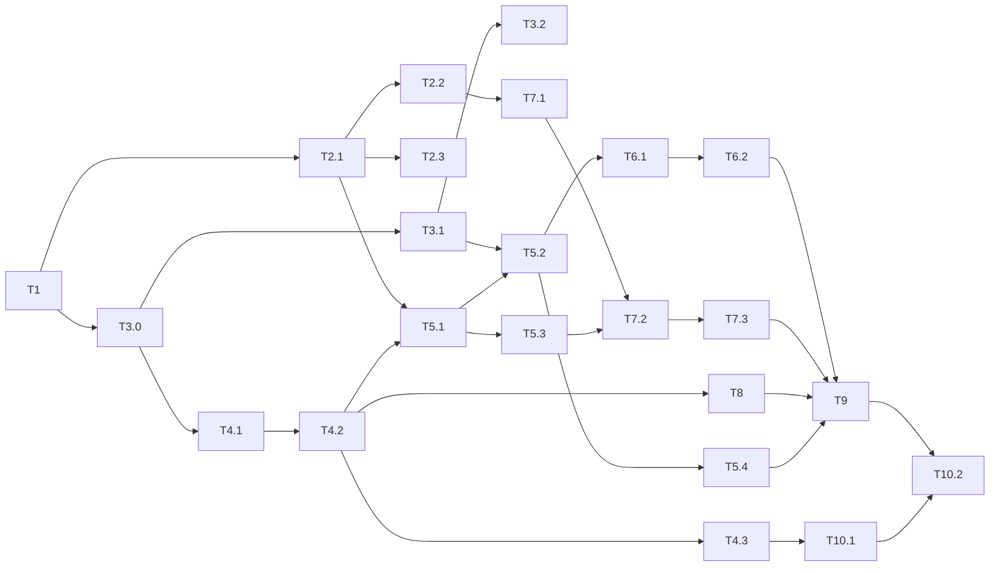

# Native Home Assistant schedules — published output (#95)

Status: specification revised after owner decisions, 2026-11-26. **Not yet approved for
implementation: three runtime proofs (§6) must pass first.** The previous 600-line
"native helpers as editable source" draft is superseded and archived in the issue.

Tracking issue: https://github.com/movrack/ha_weekly_planner/issues/95.
Owner decisions: `DECISIONS.md`, entry “Native schedules are a generated YAML output”.

## 1. Goal

Weekly Planner publishes, for chosen devices, a genuine Home Assistant `schedule` entity that
reflects the device's effective plan (priorities, modes, conditions, pauses, holidays already
resolved). Other integrations and automations read it like any native schedule. The first
consumer is Intelligent Heating Pilot (IHP) native Direct Control: IHP preheats, Weekly keeps
executing normal transitions, end settings and defaults exactly as today.

Weekly stays the only editable source of times. Nothing changes for editing, rights or execution.

## 2. Why this design (verified on HA 2026.10.4)

| Fact | Evidence |
|---|---|
| Creating/updating/deleting a UI `schedule` helper is admin-only. | `helpers/collection.py:612,635,650` |
| The `schedule` integration offers no service/public API for an integration to write a UI helper; only `get_schedule` and admin `reload`. | `components/schedule/__init__.py:170–224` |
| YAML `schedule:` entries accept per-block scalar `data`. | `components/schedule/__init__.py:118–147` |
| `schedule.reload` is admin-only only for calls carrying a user; system-context calls pass. | `helpers/service.py:966–985` |
| YAML schedules are `editable: false` in the HA editor; reload updates existing entities in place. | `components/schedule/__init__.py` `Schedule.from_yaml`, `async_update_config` |
| IHP's native reader calls `schedule.get_schedule`, reads block `data`, scans today + 7 days, uses the earliest future block. | IHP `native_schedule_reader.py` |

Owner rule: every user, admin or not, edits times in Weekly. Writing UI helpers would need a
privileged bypass; YAML generation is the only supported path. Accepted consequence: published
schedules are read-only in HA's helper editor (for admins too); edit them in Weekly.

## 3. Scope

In scope:
- Per-device option “Publish an HA schedule”, off by default, with a short explanation
  (FR/EN) of what it does and when it is useful (IHP, SHC, automations).
- Generation of one YAML `schedule` per published device, in a Weekly-owned package file,
  followed by `schedule.reload`.
- Block `data` carrying the resolved value when the action exposes one (`temperature`,
  `preset_mode`, `brightness`, `position`…), plus `weekly_planner_program` / `weekly_planner_setting`.
  No action catalogue: unknown actions publish the block without a value field.
- IHP cooperation documented and tested; Weekly execution unchanged.

Out of scope (separate issue): planning-only role where an external controller (SHC) executes
everything and Weekly sends nothing. Also out: editing published schedules in HA, external block
overrides, native helpers as source, migration of times.

## 4. Generation contract

- **What is published:** the device's effective timeline, not the program sources. Gaps = no
  requested setting (native `off`), never an invented off/eco value. The configured rest-of-time
  setting is published as blocks only when the device option “Include the rest of the time” is
  on (off by default, see §5).
- **Dated vs weekly:** a native schedule repeats weekly, while sun times, random delays and
  holidays vary by date. Weekly writes a rolling window: each weekday list holds that weekday's
  next occurrence (today … today+6). Regenerate after midnight and on any change. Whether IHP can
  ever act on today+7 before the next regeneration must be proved (§6).
- **Overnight:** split at midnight into native fragments. One-shots become a short scaffold
  block (convention chosen in the spike, not an imposed 1-second rule).
- **Writes:** only when the generated content changes; coalesce bursts (midnight, many edits);
  stable sorted output so identical plans give identical files. One reload per write.
- **File and entities:** `<config>/packages/weekly_planner_schedules.yaml` (name to confirm in the
  spike); entity id stable from the device (`schedule.weekly_<device_slug>`), name in the user's
  language. If HA packages are not enabled, show a Repairs notice with the one line to add;
  never edit `configuration.yaml` automatically.
- **Disabling the option / removing a device / uninstalling:** remove its entry, write, reload.
  On uninstall, remove the package file. User files are never touched.
- **Rights:** unchanged. Generation runs in system context from data users were already allowed
  to save (`rights.py`). Published schedules give nobody extra control.

## 5. IHP cooperation

IHP reads the published schedule and preheats toward the next block's `temperature`/preset.
Weekly applies the normal start, end settings (#93 committed ends) and defaults as today.
Nothing for the user to automate. Weekly does not call IHP and does not display IHP's preheat
(possible later follow-up).

**IHP refresh marker (owner, 2026-11-26).** IHP v0.8.0 rereads a native schedule only when its
state, `next_event` or an attribute named `actions` changes (`event_bridge._has_meaningful_scheduler_change`).
While a block is active, editing a later block changes none of these, so IHP keeps a stale target
until the active block ends (measured). For devices followed by IHP, Weekly writes
`actions: "rev-<n>"` into the data of every published block, `<n>` changing whenever that
device's published plan changes. The active block's attribute then changes on reload and IHP
recalculates immediately (measured). Between blocks no marker is needed: editing the next block
moves `next_event`. This relies on IHP's internal filter, not a documented contract: a Weekly
test must pin this behaviour against each supported IHP version. Manual fallback only:
`homeassistant.reload_config_entry` on the IHP entry (measured ≈25 s; effect on an active preheat
untested). Not automated.

**Rest-of-time blocks shadow anticipation (measured).** IHP targets the earliest future block,
including a published rest-of-time (eco) block, so the comfort block after it is only anticipated
once eco has started. Decision (owner, 2026-11-26): per-device option “Include the rest of the
time”, **off by default**; off, rest-of-time intervals are published as gaps (native `off`), so
IHP anticipates the next requested block. Weekly still applies the rest-of-time setting itself.

## 6. Proofs required before implementation (real local HA test instance)

1. **YAML + reload:** generate, reload, edit, reload: entity id and history kept; an active block
   does not fire `block_started` again on an unchanged reload; packages missing → clear notice.
2. **IHP:** pinned IHP version reads the published schedule, refreshes after reload, cancels or
   adapts preheat when the plan changes or a block disappears; Weekly normal/end execution
   unaffected.
3. **Rolling window:** today vs +7 with different sun/holiday, midnight regeneration, DST,
   pause, Weekly stopped: IHP never acts on a stale repeated weekday.

### Results, 2026-11-26 (local HA 2026.10.3 on 127.0.0.1, IHP v0.8.0, demo thermostat)

1. **Passed.** Entity/registry id kept across reloads; active block data updates; unchanged reload
   emits nothing; reload from an automation (no user) works; HA editor refuses edits. Caveat:
   moving the **end** of the active block fires one extra `block_started` (on→on with new
   `next_event`); Weekly does not use it, user automations may.
2. **Passed with the refresh marker.** IHP reads block `temperature` (drive option on). Without
   the marker, a later-block edit during an active block stays unseen (also after a demo
   thermostat change); with `actions` changed, seen at once.
3. **Passed, with one limit.** IHP rereads the whole schedule at each recalculation (no cache)
   and takes the earliest future block over 8 days. Running IHP's reader: spring/autumn DST
   resolve 06:00 local correctly; a holiday today still targets tomorrow; with days +1..+6 empty
   it falls back to today's list next week (beyond IHP's 6 h lead, harmless with daily
   regeneration). A block starting in the missing DST hour (02:30) is placed at 03:30: Weekly must
   not publish a start inside that hour. Weekly stopped (runtime): with a preheat active
   (thermostat 20 → 30 °C), emptying the published schedule made IHP restore 20 °C. So orderly
   unload/disable must publish an empty schedule. **Limit:** after a crash the last published
   week stays, and IHP keeps preheating on it while Weekly applies no end; document it.

## 7. Acceptance (after approval)

Python tests (frozen time) for generation: fixed, solar, random, overnight, one-shot, holiday,
modes, conditions, pause, priorities, two devices, rest-of-time, no-setting gaps, idempotent
writes and coalescing; performance on the 50×4×3×7×6 workload with <50 ms callbacks. Card:
option + explanation FR/EN, checked at 360×780 and desktop. Docs: SPEC, README, CHANGELOG,
GLOSSARY. Bronze rules unchanged.

## 8. Checklist

- [x] Owner decisions consolidated (2026-11-26).
- [x] Rights and write paths verified in HA source.
- [x] Proofs 1–3 on a local test instance (results above).
- [ ] Approve implementation; mark issue `ready-for-agent`.
- [ ] Implement generation, option, docs and tests.
- [ ] Open the separate planning-only (SHC) issue.

## 9. Implementation tasks (in order, one at a time)

Owner green light 2026-11-26. Each task is a separate change: tests green, Bronze kept, no
deployment. Do not start a task before the previous one is merged on the work branch.

1. **Baseline.** Start a branch from the current `develop` containing #93 (committed ends);
   do not copy the paused heating prototype. Carry over this plan and the 2026-11-26 decisions.
2. **Settings model.** `store.config.published_schedules`: `{entity_id: {include_rest: false}}`
   (presence = publication on). Validation, storage minor version bump with refusal of a newer
   file (as holiday), WS read/save with existing rights checks, YAML import/export. No UI yet.
3. **Effective plan per device (pure function).** From the resolver/timeline, compute for one
   device the dated intervals for today … today+6: value, setting id, program id, rest-of-time
   flag, one-shots marked. Reuse existing priority/mode/condition/pause/holiday logic, no parallel
   resolver. Unit tests with frozen time (fixed, solar, random, overnight, one-shot, holiday,
   modes, conditions, pause, priorities, two devices, no-setting gaps).
4. **Native codec (pure function).** Effective plan → native weekday lists: rolling window
   (each weekday = its next date), midnight split, rest-of-time dropped unless `include_rest`,
   one-shot scaffold convention, no start inside the missing DST hour, value fields only when the
   action exposes them (`temperature`, `preset_mode`, `brightness`, `position`…) plus
   `weekly_planner_program`/`_setting`, and `actions: "rev-<n>"`. Stable sorted output; HA
   schema validation in tests (`schedule` CONFIG_SCHEMA).
5. **Publisher.** Writes the package file atomically (temp + rename) only when content changes,
   coalesces bursts, calls `schedule.reload` in system context; regenerates after midnight and on
   every plan change (edits, modes, conditions, pause, holiday, skip). `rev` increments per device
   on change. Repairs issue when packages are not enabled (never edits `configuration.yaml`).
   Performance test on the 50×4×3×7×6 workload (<50 ms callbacks, write counts).
6. **Lifecycle.** Option off / device removed → entry removed; integration unload → publish
   empty schedules; uninstall → remove the package file and reload. Restart: regenerate before
   first publish, stale generations never overwrite newer ones. Tests for each path.
7. **Card UI.** Per-device switches “Publish an HA schedule” and “Include the rest of the time”
   (second only when the first is on), short FR/EN explanations including the IHP crash limit;
   show the published entity id. Admin and non-admin per existing rights. Check at 360×780 and
   desktop, light/dark; `mamy` review.
8. **IHP contract test.** Automated test pinning IHP's refresh behaviour (`actions` attribute,
   empty schedule restores) against the supported IHP version, documented as a compatibility claim.
9. **Real-instance check.** Local test HA with IHP: publish, edit during an active block,
   midnight regeneration, unload; captures kept.
10. **Docs and release.** SPEC, README (FR/EN), GLOSSARY, CHANGELOG, wiki page; known limits
    (read-only in HA editor, extra `block_started` when an active end moves, crash limit, IHP
    internal filter). `heimdall` check before release.

Follow-up issue (not #95): planning-only role with a complete external executor (SHC).

## Task tree, status and dependencies (owner, 2026-11-26)

**Status rule:** open issue = to do · label `in-progress` = in progress · closed = done. Each task is a sub-issue of #95; subtasks are sub-issues of their task; GitHub "blocked by" links carry the dependencies below.

**Parallel rule:** a task may start when all its "depends on" are closed. Tasks running together must own disjoint files (column "Files owned"). Shared files (`translations/*.json`, `engine.py`) have a single owner task.

**Model rule:** recommended model per task. Small models (Haiku) for bounded, well-specified tasks; Sonnet for module work with tests; Opus for engine integration. At launch the coordinator gives the agent only the context needed (files, contracts, decisions, test commands) and runs a short Q&A check before the agent edits anything.

| Task | Issue | Depends on | Files owned | Model |
|---|---|---|---|---|
| T1 Baseline branch | #96 | — | branch only | Haiku · Codex Luna |
| T2 Settings model | #97 | (subtasks) | | |
| T2.1 Schema, validation, storage version | #98 | T1 | validation.py, store.py, migration.py, const.py | Sonnet · Codex Sol |
| T2.2 WS read/save with rights | #99 | T2.1 | websocket.py, rights.py | Sonnet · Codex Sol |
| T2.3 YAML import/export | #100 | T2.1 | yaml_file.py | Haiku · Codex Luna |
| T3 Effective 7-day plan | #101 | (subtasks) | | |
| T3.0 Shared data types | #102 | T1 | publish_types.py (new) | Haiku · Codex Luna |
| T3.1 Dated intervals today…+6 | #103 | T3.0 | publish_plan.py (new) | Opus |
| T3.2 Plan test matrix | #104 | T3.1 | tests/test_publish_plan.py | Sonnet · Codex Sol |
| T4 Native codec | #105 | (subtasks) | | |
| T4.1 Rolling window, midnight, DST | #106 | T3.0 | native_codec.py (new) | Sonnet · Codex Sol |
| T4.2 Block data and `actions` marker | #107 | T4.1 | native_codec.py | Haiku · Codex Luna |
| T4.3 Codec tests + HA schema | #108 | T4.2 | tests/test_native_codec.py | Sonnet · Codex Sol |
| T5 Publisher | #109 | (subtasks) | | |
| T5.1 Atomic write + system reload | #110 | T4.2, T2.1 | publisher.py (new) | Sonnet · Codex Sol |
| T5.2 Regeneration triggers | #111 | T5.1, T3.1 | engine.py, publisher.py | Opus |
| T5.3 Repairs notice (packages) | #112 | T5.1 | repairs.py, translations/*.json | Haiku · Codex Luna |
| T5.4 Performance test | #113 | T5.2 | tests/test_performance*.py | Sonnet · Codex Sol |
| T6 Lifecycle | #114 | (subtasks) | | |
| T6.1 Off/removed/unload/uninstall | #115 | T5.2 | __init__.py, publisher.py | Sonnet · Codex Sol |
| T6.2 Restart, generation ordering | #116 | T6.1 | publisher.py, tests | Sonnet · Codex Sol |
| T7 Card UI | #117 | (subtasks) | | |
| T7.1 Per-device switches | #118 | T2.2 | frontend device editor + tests | Sonnet · Codex Sol |
| T7.2 FR/EN explanations | #119 | T7.1, T5.3 | frontend + backend translations | Haiku · Codex Luna |
| T7.3 Visual check + mamy | #120 | T7.2 | captures | Sonnet · Codex Sol |
| T8 IHP contract test | #121 | T4.2 | tests/test_ihp_contract.py | Haiku · Codex Luna |
| T9 Real-instance check with IHP | #122 | T6.2, T7.3, T8, T5.4 | captures, report | Sonnet · Codex Sol |
| T10 Docs and release | #123 | (subtasks) | | |
| T10.1 SPEC and GLOSSARY | #124 | T4.3 | docs/SPEC.md, GLOSSARY.md | Haiku · Codex Luna |
| T10.2 README, CHANGELOG, wiki, heimdall | #125 | T9, T10.1 | README*, CHANGELOG, wiki/ | Sonnet · Codex Sol |

Parallel waves: (1) T1 · (2) T2.1, T3.0 · (3) T2.2, T2.3, T3.1, T4.1 · (4) T3.2, T4.2, T7.1 · (5) T4.3, T5.1, T8 · (6) T5.2, T5.3, T10.1 · (7) T5.4, T6.1, T7.2 · (8) T6.2, T7.3 · (9) T9 · (10) T10.2.

Detailed agent briefs (context, contracts, acceptance, test commands) are added to each sub-issue before its launch.

