# Atlas des écrans

[Lire le guide pas à pas](GUIDE.fr.md)

Les captures de Weekly Planner ont été réalisées le 29 octobre 2026,
avec des programmes et appareils de démonstration du salon. Les écrans utilisent
les vrais composants de l’application ; leurs données sont préparées pour
expliquer les fonctions. Les vues d’historique, de profil et d’options sont celles
de Home Assistant local. Le sélecteur natif porte le nom « Profil Bureau » : il
illustre le mécanisme réel avec un programme de test distinct des exemples du
salon. Aucune configuration de production n’a été modifiée.

Les modifications de programme n’ont pas été enregistrées pour réaliser cet
atlas. Le bandeau de la capture S21 utilise un enregistrement simulé en mémoire,
sans appel d’écriture au serveur. Les images documentent les écrans ; elles ne
prouvent pas à elles seules le fonctionnement d’un appareil réel.

Les captures principales sont prises sur un téléphone de **360 × 780 pixels CSS**,
en thème clair, sauf la fenêtre agrandie sur ordinateur. Cliquer sur une miniature
permet d’ouvrir l’image complète. Les écrans longs disposent de captures de suite.

## Création, pièce, filtres et graphique

S37 à S45 ont été capturés le 29 octobre 2026 à 360 × 780 pixels CSS, sur
l’instance locale, avec les vrais composants et des données préparées en mémoire.
Aucune sauvegarde ni commande d’appareil n’a été exécutée. Les sélecteurs natifs
utilisent les appareils de test. Les images d’action, de cadran et de graphique
sont des fragments. Le fond clair du montage ne valide pas tous les thèmes.

### S37 — Créer un programme

Donner un nom, ajouter un appareil, puis cocher les commandes utiles. Aucune commande n’est sélectionnée au départ.

<a href="images/guide/s37-create-actions.png">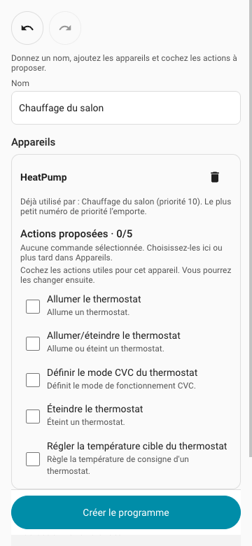</a>

### S38 — Choisir ou préparer un mode

Mode actif agit immédiatement. Mode à modifier prépare les horaires sans les activer.

<a href="images/guide/s38-modes-manual.png">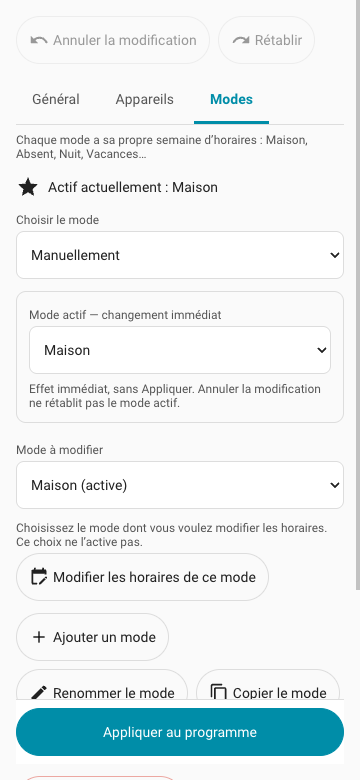</a>

### S39 — Suivre une entité

Associer chaque état à un mode. Ici, Présence activée correspond à Maison et désactivée à Vacances : exemple à adapter, sans règle imposée.

<a href="images/guide/s39-modes-external.png">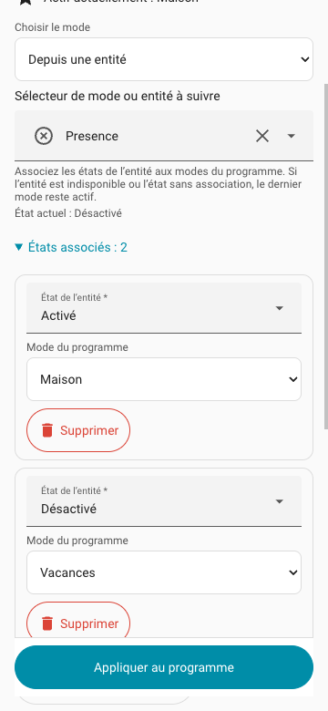</a>

### S40 — Zone du programme

Définir la pièce dans Général (« Pièce du programme ») puis Appliquer au programme. Elle ne vient pas automatiquement des pièces des appareils.

<a href="images/guide/s40-program-area.png">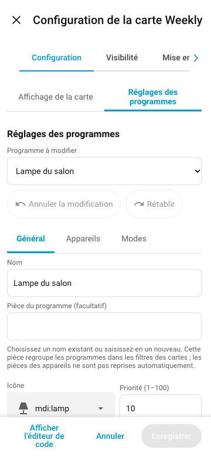</a>

### S41 — Filtres et présentation

Choisir la pièce, les programmes à afficher et la présentation de la journée. Les interrupteurs « Bouton Graphique sous chaque appareil » et « Graphique ouvert d’office » règlent le graphique.

### S42 — Appuyer sur un autre bouton

Fragment du réglage d’action. Le bouton de test s’appelle Push ; choisir le vrai bouton de position favorite de son installation. Aucune commande n’a été exécutée.

<a href="images/guide/s42-action-target.png">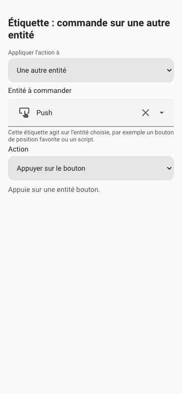</a>

### S43 — Lire une valeur dans une entité

Fragment du réglage d’action. Ici temperature est la consigne du thermostat de démonstration, pas sa température mesurée. La valeur sera lue au moment de l’exécution.

<a href="images/guide/s43-action-source.png">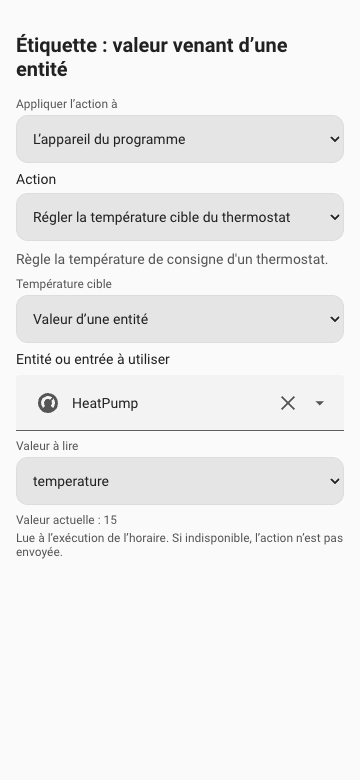</a>

### S44 — Double cadran de 12 heures

Fragment du cadran. Intérieur : 0–12 h ; extérieur : 12–24 h. Confort : 6 h 30–8 h 30 et 17–22 h. Le gris indique ici qu’aucune action n’est prévue.

<a href="images/guide/s44-radial-double.png">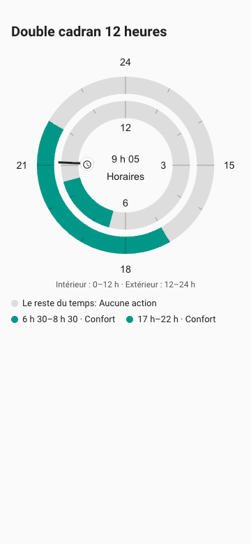</a>

### S45 — Graphique sans données

Fragment du graphique pour une journée future sans horaires. Les messages distinguent l’historique futur de l’absence d’action prévue.

<a href="images/guide/s45-chart-empty.png">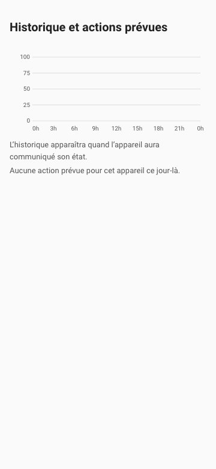</a>

## Autres écrans

## S01 — Vue d’ensemble

Les programmes du salon montrent leur état, leur prochaine action, leur interrupteur et la barre du jour ; le bouton **Graphique du jour** est ouvert sous la lampe.

<a href="images/guide/s01-overview.png">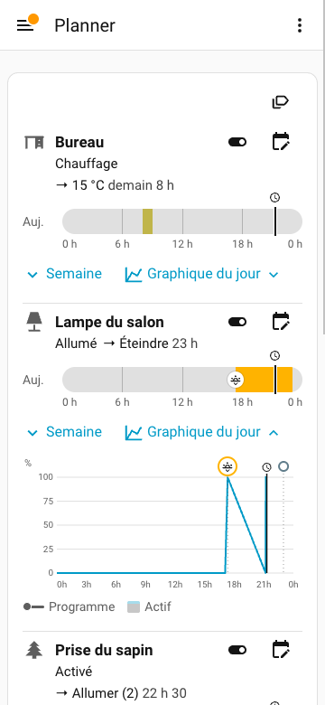</a>

## S02 — Un seul programme

Une carte fixée sur le chauffage du salon donne accès à ses horaires sans ouvrir la bibliothèque globale des réglages.

<a href="images/guide/s02-one-program.png">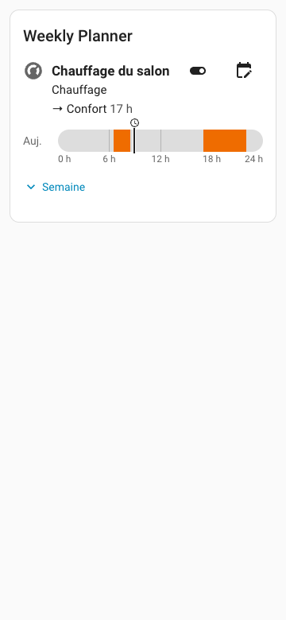</a>

## S03 — Cadran de 24 heures

Le cadran présente les plages du jour et leur légende. Un clic ouvre les horaires ; les arcs ne se déplacent pas directement.

<a href="images/guide/s03-radial.png">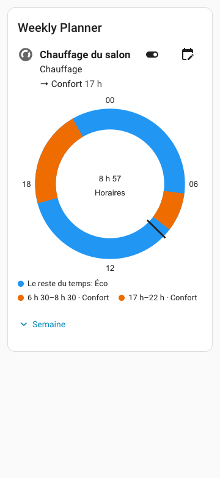</a>

## S04 — Liste compacte

La liste rassemble les programmes, leurs prochaines actions et leurs interrupteurs dans des lignes courtes.

<a href="images/guide/s04-compact-list.png">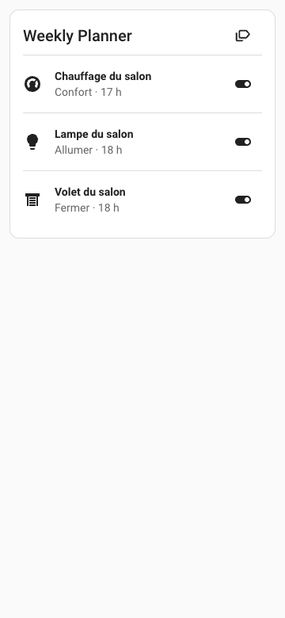</a>

## S05 — Semaine dépliée

Le bouton Semaine affiche les sept jours. Le nom d’un jour ouvre ses horaires.

<a href="images/guide/s05-week-expanded.png">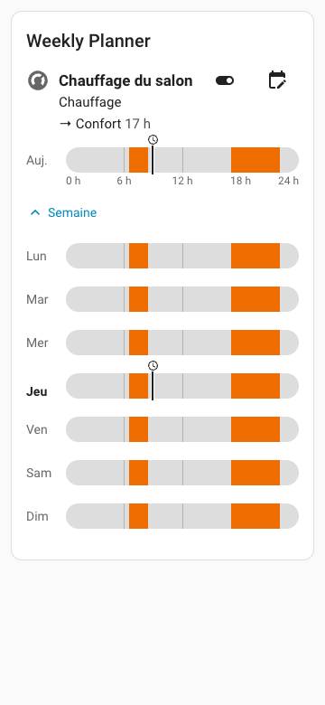</a>

## S06 — Tous les horaires

La fenêtre des horaires rassemble le schéma de la semaine, les plages et le réglage du reste du temps.

<a href="images/guide/s06-schedules.png">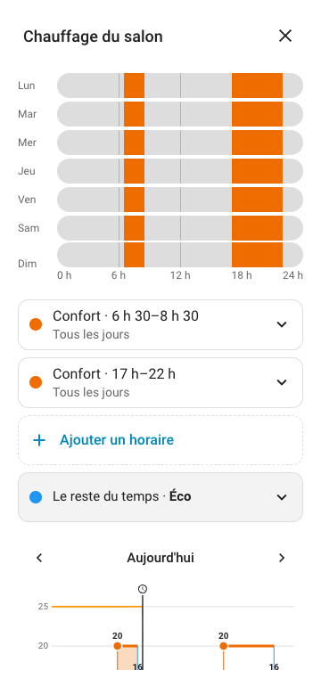</a>

## S07 — Horaires d’un jour

Le jour sélectionné limite la liste affichée. Le retour à la semaine permet de retrouver l’ensemble.

<a href="images/guide/s07-one-day.png">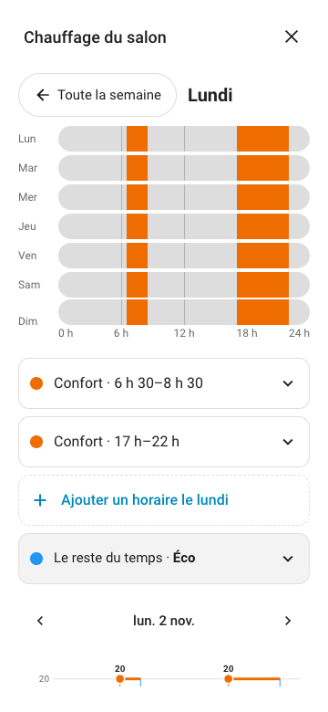</a>

## S08 — Modifier une plage

Le formulaire contient le début, la fin facultative, les jours et le réglage. La suite de la capture montre les contrôles placés plus bas.

<a href="images/guide/s08-slot-form.png">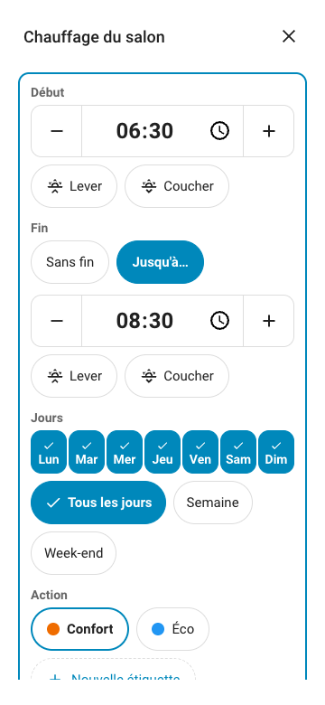</a>

Suite de l’écran :

<a href="images/guide/s08-slot-form-suite.png">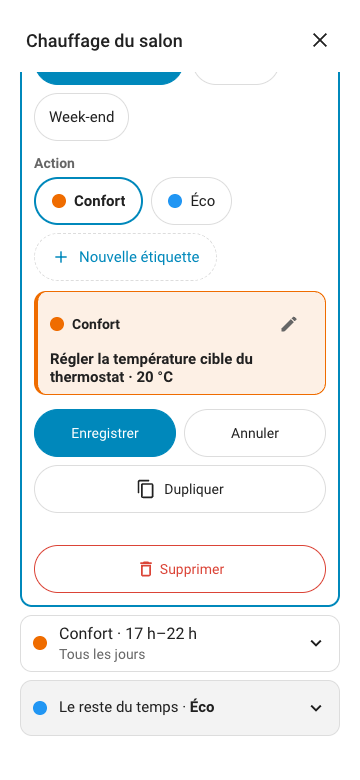</a>

## S09 — Utiliser le soleil

Les choix Lever et Coucher remplacent l’heure fixe par un événement solaire. Les boutons − et + changent son décalage. Les champs facultatifs **Au plus tôt à** et **Au plus tard à** empêchent l’heure de sortir d’une plage ; une phrase dessous donne l’heure réelle (« coucher du soleil + 30 min, mais pas avant 18:00 ni après 19:00 ») et le résultat d’aujourd’hui.

<a href="images/guide/s09-solar-slot.png">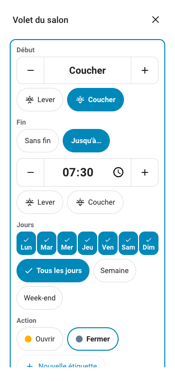</a>

## S10 — Action sans fin

Sans fin crée une action ponctuelle : elle est lancée au début, sans retour automatique au réglage par défaut.

<a href="images/guide/s10-one-shot.png">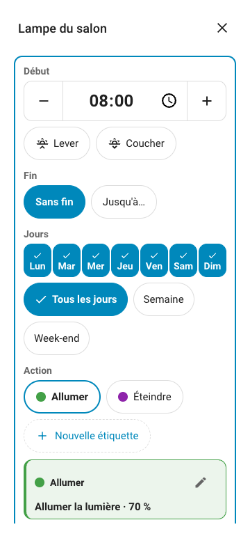</a>

## S11 — Créer un réglage

Le formulaire intégré définit le nom, la couleur et l’action. L’enregistrement se fait avec celui de l’horaire.

<a href="images/guide/s11-new-label.png">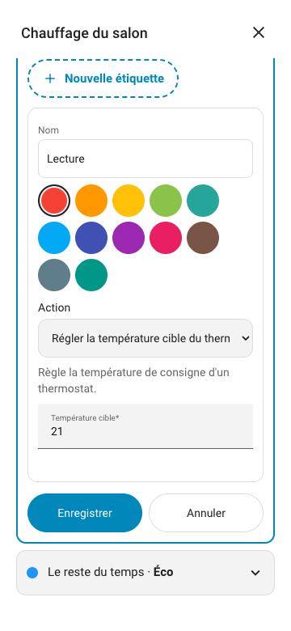</a>

## S12 — Modifier un réglage partagé

Le crayon ouvre le réglage sélectionné. La mention Partagé indique qu’une modification peut concerner d’autres programmes.

<a href="images/guide/s12-edit-shared-label.png">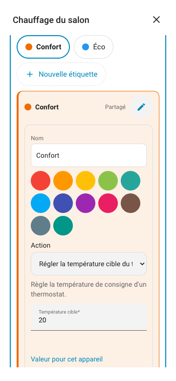</a>

## S13 — Valeur propre à un appareil

Une valeur propre adapte l’action pour cet appareil. Revenir à la valeur commune supprime cette exception.

<a href="images/guide/s13-device-value.png">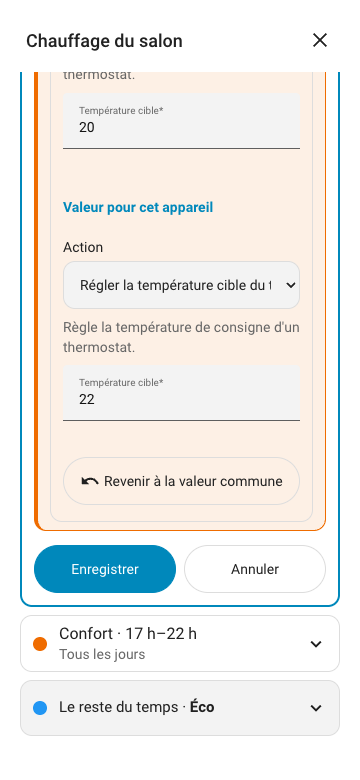</a>

## S14 — Le reste du temps

Ce choix définit l’action par défaut de l’appareil. Ne rien changer signifie qu’aucune action par défaut n’est envoyée.

<a href="images/guide/s14-rest-of-time.png">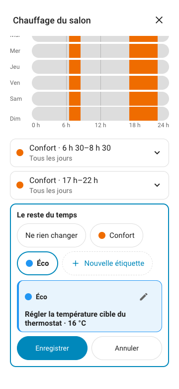</a>

## S15 — Graphique du jour

Le bouton **Graphique du jour** ouvre le graphique sous l’appareil, avec sa légende (Programme, Actif). Le graphique rapproche les actions prévues et l’historique disponible.

## S16 — Historique Home Assistant

Un toucher du graphique ouvre l’historique natif de l’entité dans Home Assistant.

<a href="images/guide/s16-ha-history.png">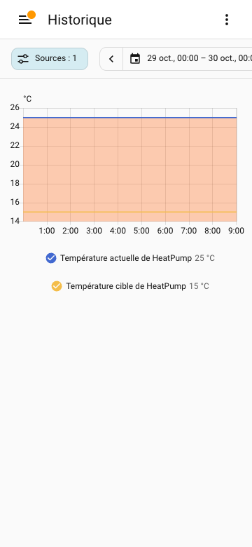</a>

## S17 — Fenêtre agrandie sur ordinateur

Un clic sur le titre élargit la fenêtre. Sur téléphone, la fenêtre utilise déjà tout l’écran.

<a href="images/guide/s17-expanded-dialog.png">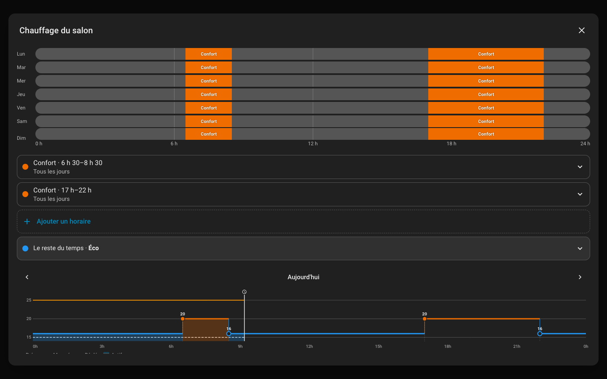</a>

## S18 — Édition directe sur une barre

Un clic à la souris ou un appui long au doigt affiche les poignées et les actions de la plage sélectionnée.

<a href="images/guide/s18-bar-edit.png">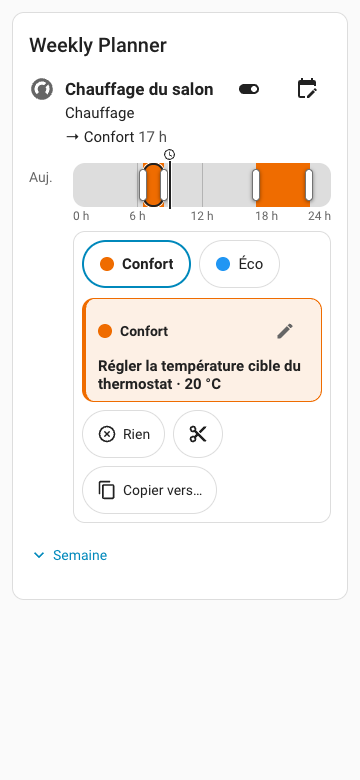</a>

## S19 — Copier vers d’autres jours

Choisir les jours de destination prépare la copie de la plage sélectionnée.

<a href="images/guide/s19-copy-days.png">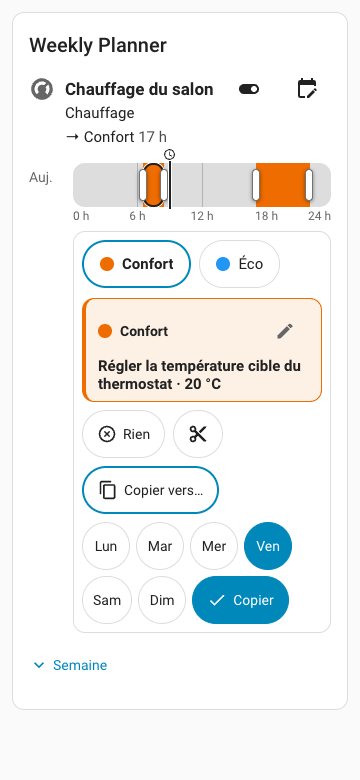</a>

## S20 — Chevauchement lors d’une copie

Les aperçus Avant et Après montrent le résultat. Chaque jour en conflit peut être remplacé ou exclu de la copie.

<a href="images/guide/s20-copy-conflict.png">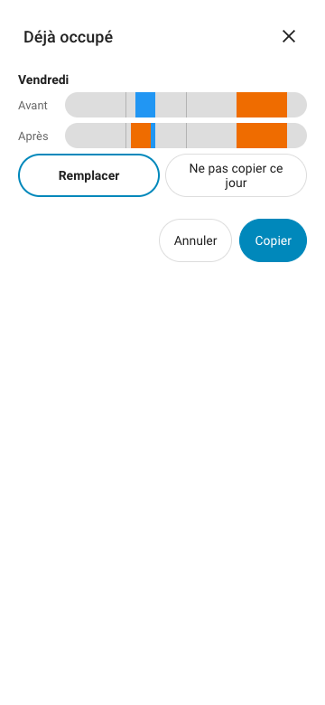</a>

## S21 — Annuler une modification de barre

Après l’enregistrement au relâcher, le bandeau Modifié · Annuler permet de revenir brièvement en arrière.

<a href="images/guide/s21-bar-undo.png">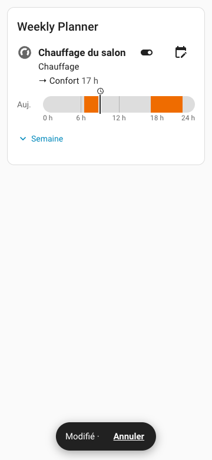</a>

## S22 — Bibliothèque des réglages

L’écran global liste les réglages, leurs actions et leur utilisation. Il s’ouvre depuis une carte avec plusieurs programmes.

<a href="images/guide/s22-label-library.png">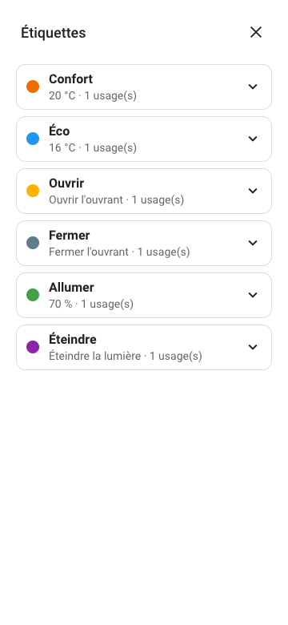</a>

## S23 — Modifier dans la bibliothèque

Nom, couleur et action se règlent dans une seule fiche. La suite de la capture montre les commandes inférieures.

<a href="images/guide/s23-label-library-edit.png">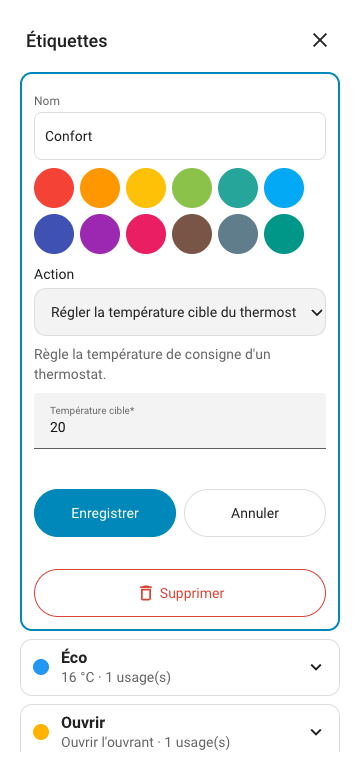</a>

Suite de l’écran :

<a href="images/guide/s23-label-library-edit-suite.png">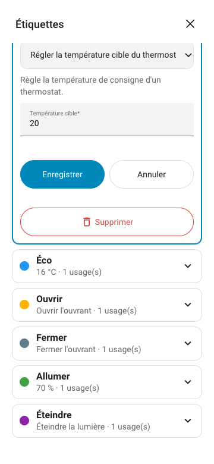</a>

## S24 — Affichage : liste filtrée

Choix de la pièce, présentation de la journée et réglages du graphique pour « Plusieurs appareils ».

<a href="images/guide/s24-card-filter-settings.png">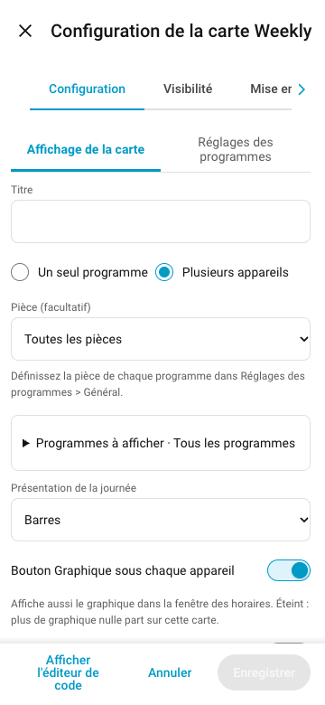</a>

## S25 — Affichage : un programme

Le programme fixé à la carte peut être présenté en barres, en cadran de 24 heures ou en liste compacte.

<a href="images/guide/s25-card-one-settings.png">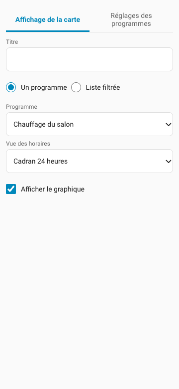</a>

## S26 — Choisir le programme à configurer

Le menu est fermé sur cette capture : sa liste native n’est pas exportée par la capture du navigateur. Son ordre est Choisir un programme, Nouveau programme, puis les programmes existants, avec des séparateurs.

<a href="images/guide/s26-program-selector.png">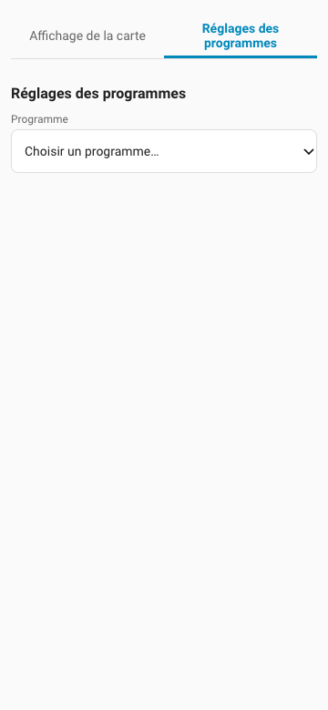</a>

## S27 — Créer un programme

Choisir les appareils avant l’icône. Les réglages ne sont envoyés qu’avec Appliquer au programme.

<a href="images/guide/s27-new-program.png">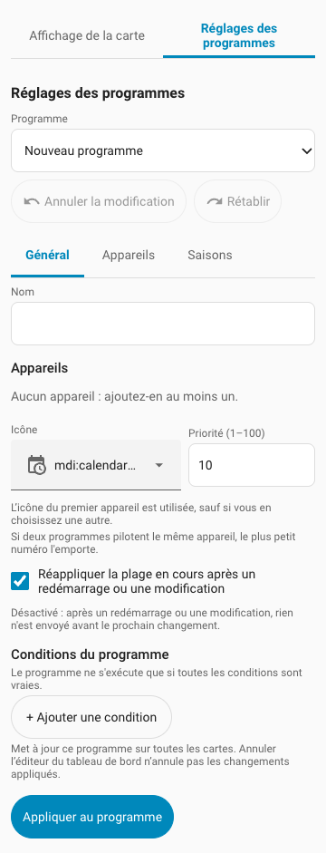</a>

## S28 — Réglages généraux et historique local

Les boutons Annuler la modification et Rétablir parcourent le brouillon local. Les avertissements indiquent les autres programmes utilisant les appareils sélectionnés.

<a href="images/guide/s28-program-general-history.png">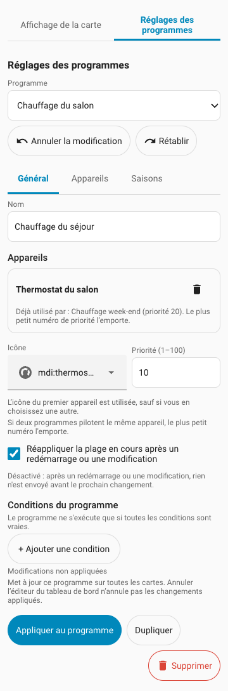</a>

## S29 — Conditions du programme

Une condition compare l’état ou un attribut d’une entité. Toutes les conditions du programme doivent être satisfaites pour ses plages.

<a href="images/guide/s29-program-conditions.png">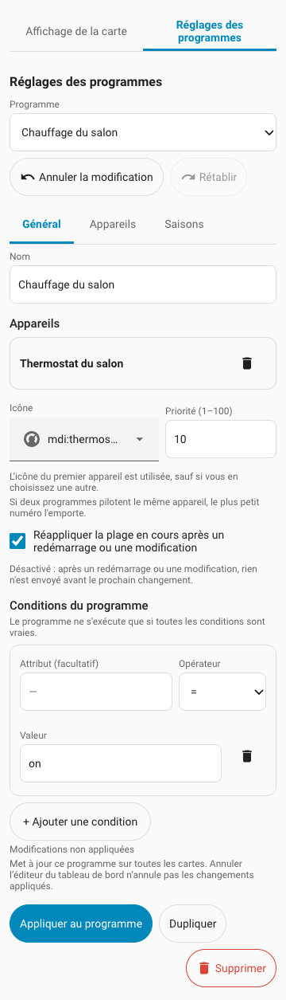</a>

## S30 — Actions proposées par appareil

La liste limite les services proposés pour cet appareil. Toutes signifie que les actions compatibles restent disponibles.

<a href="images/guide/s30-device-actions.png">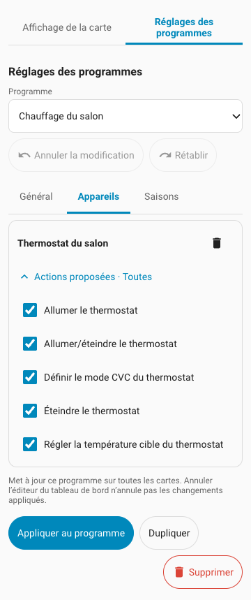</a>

## S31 — Gérer les modes

Le mode actif et le mode à gérer sont distingués. Ajouter, renommer, copier et supprimer modifient le brouillon.

<a href="images/guide/s31-season-management.png">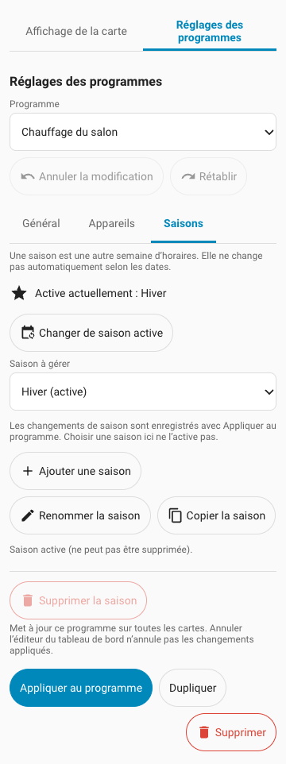</a>

## S32 — Nom de mode en cours

Le nom est enregistré avec Appliquer au programme. Le bouton de changement de mode actif reste indisponible tant que les changements de mode ne sont pas appliqués.

<a href="images/guide/s32-season-name-draft.png">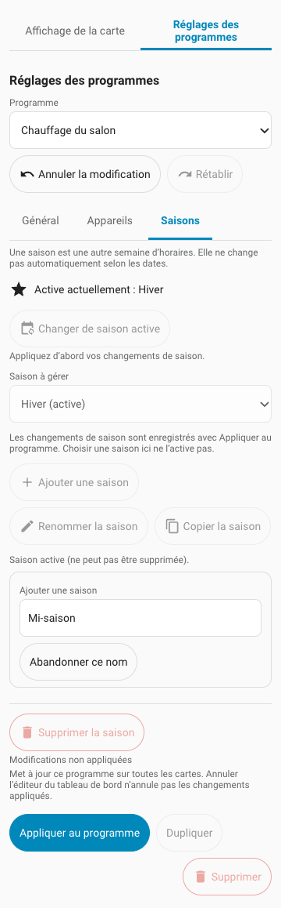</a>

## S33 — Changer le mode actif

Le bouton ouvre le véritable sélecteur de profil Home Assistant du programme, trouvé dans le registre des entités.

<a href="images/guide/s33-active-season-ha.png">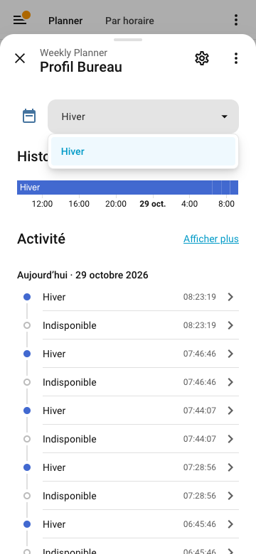</a>

## S34 — Confirmation

Les opérations concernées demandent confirmation. Cette capture montre la boîte avant toute validation.

<a href="images/guide/s34-confirmation.png">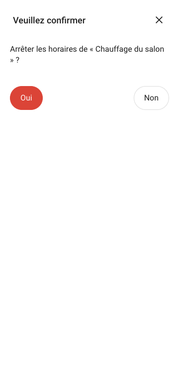</a>

## S35 — Options de l’intégration

Ces options Home Assistant concernent l’intégration entière : droits d’édition, réapplication par défaut, notifications et délai des conditions.

<a href="images/guide/s35-integration-options.png">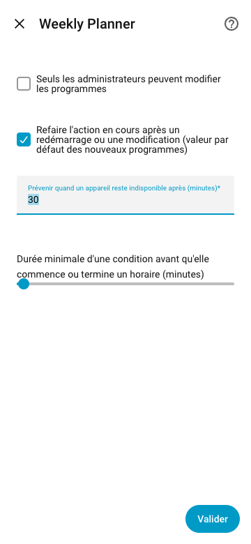</a>

## S36 — Une seule intégration suffit

Home Assistant refuse une seconde configuration de Weekly Planner. Pour ajouter un programme, utiliser Réglages des programmes dans la carte ; il n’est pas nécessaire d’ajouter une autre intégration. Cette capture est prise sur l’instance de test déjà configurée, sans supprimer l’intégration pour simuler une première installation.

<a href="images/guide/s36-single-instance.png">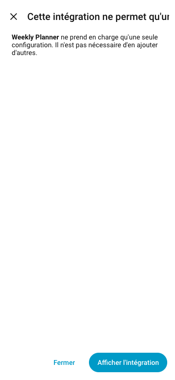</a>

## Variantes utiles

Ces états complètent les mêmes écrans sans ajouter une nouvelle façon de programmer.

### Vue d’ensemble en thème sombre

<a href="images/guide/s01-dark.png">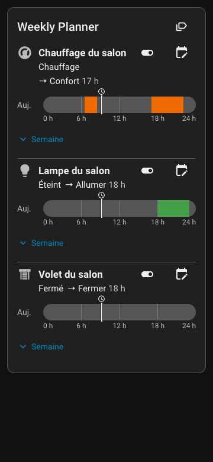</a>

### Cadran en thème sombre

<a href="images/guide/s03-dark.png">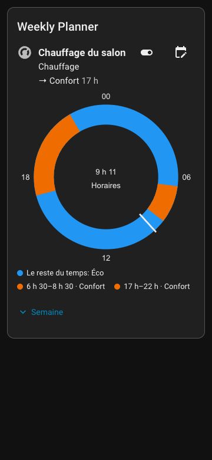</a>

### Formulaire d’horaire en thème sombre

<a href="images/guide/s08-dark.png">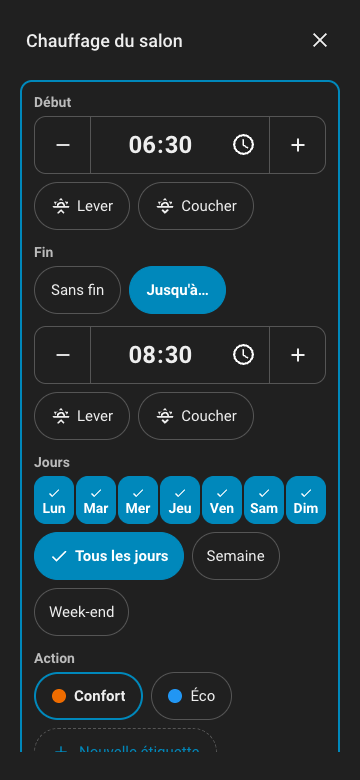</a>

### Graphique en thème sombre

<a href="images/guide/s15-dark.png">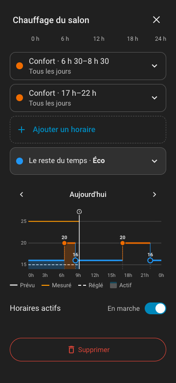</a>

### Carte sans programme

<a href="images/guide/s01-empty.png">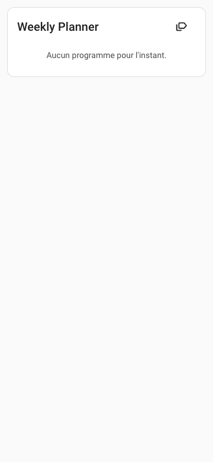</a>

### Programme en pause

### Indicateur Vacances

### Horaires en lecture seule

### Suppression refusée d’un réglage utilisé

### Validation d’un nouveau programme incomplet

### Validation d’un nom de mode

[Retour au guide pas à pas](GUIDE.fr.md) · [Inventaire des captures](SCREEN_INVENTORY.md)
