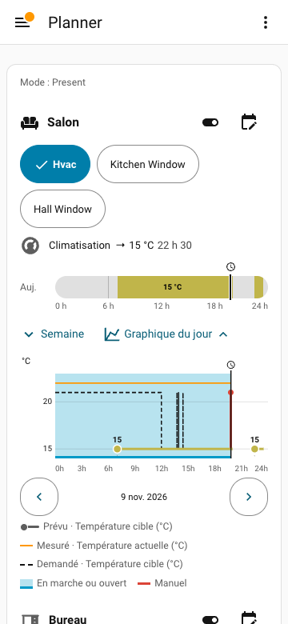
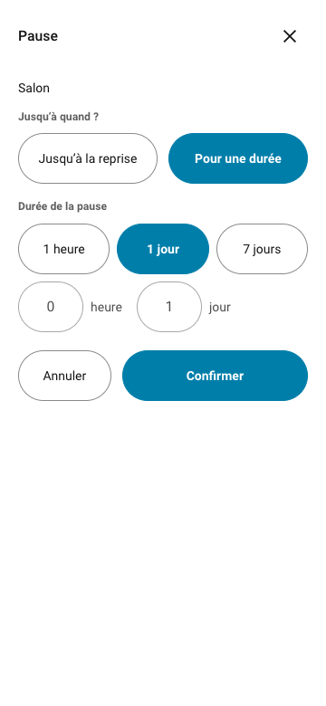
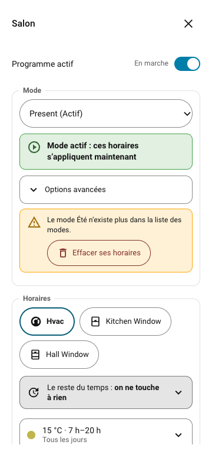
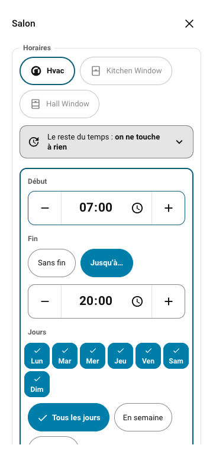
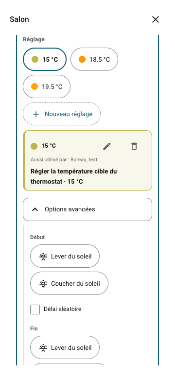
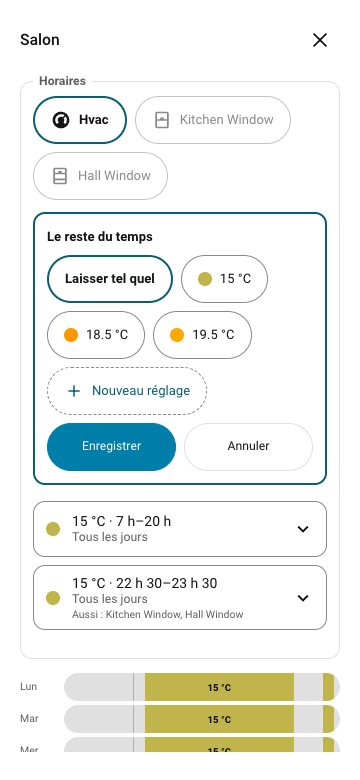
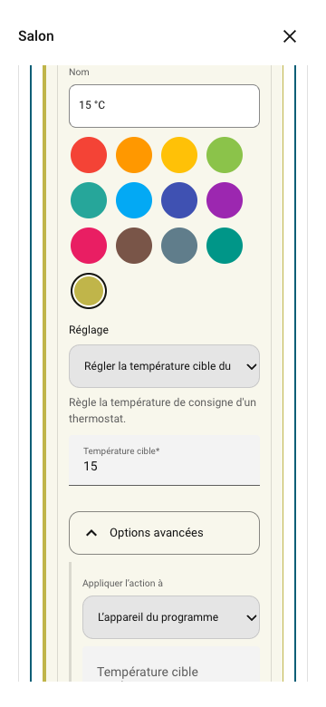
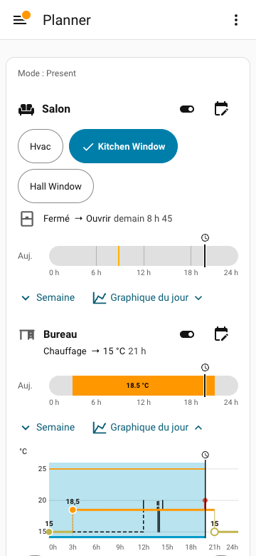
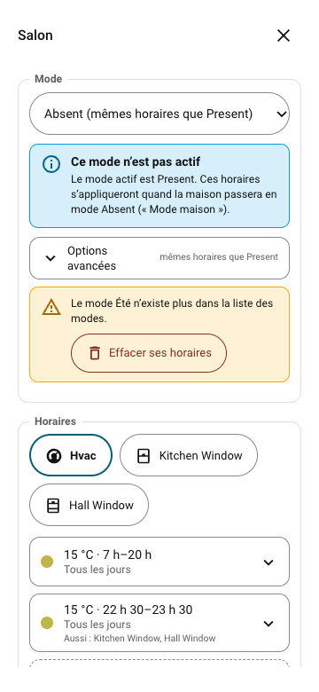

# Weekly Planner — mes horaires, simplement

Les captures montrent une maison de démonstration, sans commande d’un
appareil réel. Voir aussi les [captures S37 à S45](SCREENS.fr.md#s37).

Un **programme** réunit les appareils et leurs horaires. Un **réglage** donne
un nom à ce qu’ils doivent faire : par exemple **Confort = 20 °C**.
Un **horaire** dit quand utiliser ce réglage.

## Je veux regarder ce qui est prévu

Sur le tableau de bord, repère le nom du programme. En dessous, la flèche indique
la prochaine action et son heure. La barre colorée représente la journée ; le
petit trait avec une horloge indique maintenant.

À droite du nom :

- Le petit **interrupteur** active ou met en pause le programme.
- Le bouton en forme de **calendrier avec un crayon** ouvre les horaires.

L’interrupteur ne commande pas directement l’appareil. Mettre un programme en
pause arrête ses horaires ; cela ne veut pas forcément dire éteindre l’appareil.
Pour mettre en pause, un écran demande **Arrêter les horaires de « X » ?** puis
**Jusqu’à quand ?** ; il s’ouvre sur **Pour une durée**, avec **1 jour** choisi. L’autre
choix est **Jusqu’à la reprise** (sans limite). Avec **Pour une durée**, **Durée de la
pause** propose **1 heure**, **1 jour**, **7 jours** ou deux champs, **Nombre d’heures**
puis **Nombre de jours**, pour une durée de votre choix, de 1 heure à 365 jours au
total. On appuie ensuite sur **Confirmer**. Le programme
reprend tout seul à la fin d’une pause de durée choisie ; on peut aussi remettre
l’interrupteur en marche à tout moment, sans confirmation. Modifier les horaires
pendant une pause ne l’interrompt pas.

Quand le programme est arrêté, un badge rouge apparaît sous les icônes, en haut à
droite : **En pause** (sans limite) ou **Pause jusqu’au** suivi de la date et de
l’heure de reprise. L’écran des horaires a son propre interrupteur, **Programme actif**,
avec le texte **En marche**, **En pause** (sans limite) ou **Pause jusqu’au** suivi de la
date. Cet interrupteur se met à jour sur les autres cartes.

**Semaine** déplie les sept jours. Toucher le nom d’un jour permet de regarder ses
horaires. **Toute la semaine** revient ensuite à l’ensemble.

Selon le choix de la personne qui a préparé la carte, vous pouvez aussi voir un
[cadran de 24 heures](SCREENS.fr.md#s03), un **double cadran de 12 heures**, ou une
[liste compacte](SCREENS.fr.md#s04). Dans le double cadran, le cercle intérieur
va de 0 à 12 h et le cercle extérieur de 12 à 24 h. Les couleurs sont celles des
barres ; le gris indique qu’aucune action n’est prévue. Les repères du soleil
montrent le lever et le coucher.

[Double cadran S44](SCREENS.fr.md#s44).

Toucher une ligne compacte déplie sa barre. Toucher le calendrier ouvre les
horaires. Un clic ou un appui long sur un cadran permet de modifier ses arcs avec les poignées.
Au clavier, une poignée sélectionnée se déplace de 15 minutes avec les flèches gauche et droite ;
le changement est enregistré après un court instant. La touche Échap ferme d’abord l’éditeur
ouvert, puis la fenêtre ; dans une fenêtre, le focus reste à l’intérieur et revient à son point de départ à
la fermeture. Sur téléphone, un balayage vers le bas sur l’en-tête d’une fenêtre la ferme ; sur ordinateur, le bouton
**Agrandir / réduire** (flèches, à côté de la croix) l’élargit.

Quand un réglage est sélectionné, ses heures restent visibles au-dessus de la barre, au centre du cadran simple ou sous le cercle pour le double cadran et les textes longs, même sur téléphone. Elles se mettent à jour pendant le déplacement ou le glissé d’une poignée. Pour un horaire solaire, l’heure calculée est précisée avec le lever ou le coucher du soleil. « Dès » indique une action sans fin ; « lendemain » indique une fin après minuit. Au survol ou au focus clavier, chaque réglage affiche son nom et ses heures, sélectionné ou non, dans les barres comme sur les cercles. Le trait « maintenant » affiche l’heure actuelle au survol ou au focus, actualisée chaque minute. Sa zone de survol dépasse le trait pour le rendre facile à viser, sans gêner les poignées. Les mêmes informations sont accessibles aux lecteurs d’écran.

## Je veux du confort le matin et le soir

Prenons cet exemple pour le chauffage du salon :

| Quand ? | Ce que je veux |
|---|---|
| Tous les jours, de 6 h 30 à 8 h 30 | Confort : 20 °C |
| Tous les jours, de 17 h à 22 h | Confort : 20 °C |
| Le reste du temps | Éco : 16 °C |

### 1. Ouvrir les horaires

Toucher le **calendrier avec un crayon**, à droite de Chauffage du salon.
Les horaires déjà créés apparaissent sous les sept barres de la semaine.
Si rien n'est encore réglé pour un appareil, la carte affiche sur sa ligne un bouton **Créer un réglage** à la place des barres : il ouvre directement le formulaire d'un premier horaire pour cet appareil.
En haut de l’écran, l’interrupteur **Programme actif** arrête ou remet en marche le programme ; viennent ensuite,
dans le cadre **Mode** (si un sélecteur de mode est réglé), le choix du mode, puis le cadre **Horaires**.

### 2. Régler le matin

1. Toucher **Ajouter un horaire** (**Créer un réglage** s'il n'y en a aucun), ou la ligne du matin si elle existe déjà.
2. Sous **Début**, saisir **06:30**.
3. Sous **Fin**, choisir **Jusqu’à…**, puis saisir **08:30**.
4. Choisir **Tous les jours**.
5. Sous **Réglage**, choisir **Confort**.
6. Faire défiler jusqu’en bas et toucher **Enregistrer**.

[Voir le bas du formulaire et ses boutons](images/guide/s08-slot-form-suite.png).

Les boutons **−** et **+** déplacent l’heure de 15 minutes. Vous pouvez saisir une
heure plus précise. Si **Tous les jours** est déjà sélectionné, le toucher une
seconde fois enlève tous les jours : il faut alors en choisir à nouveau. À côté de
**Tous les jours**, **En semaine** et **Week-end** choisissent d’un coup les jours
correspondants. Quand l’horaire a été ouvert depuis un jour précis de la semaine, seul ce jour est
affiché ; **Appliquer à d’autres jours** montre alors les sept jours. Dans la vue d’un jour,
le bouton d’ajout s’appelle **Ajouter un horaire le** suivi du jour.

**Délai aléatoire** (sous **Options avancées**, pour le début et pour la fin) : cocher la case, puis
saisir **Délai maximum (minutes)**, de 1 à 240. L’action part chaque jour à un moment pris au hasard
dans ce délai ; une phrase donne la fenêtre calculée (« Dans les N prochaines minutes »). Il faut que l’horaire
garde au moins 5 minutes : sinon l’écran demande de réduire le délai ou d’allonger l’horaire.

### 3. Régler le soir

Refaire les mêmes gestes avec **17:00**, **22:00** et **Confort**, puis
**Enregistrer**.

### 4. Choisir Éco entre ces horaires

Dans le cadre **Horaires**, toucher la ligne **Le reste du temps** (elle est
au-dessus de la liste des horaires), choisir **Éco**, puis **Enregistrer**. À 8 h 30 et à 22 h, le chauffage reçoit ainsi la demande de 16 °C.

**Laisser tel quel** signifie qu’aucune action n’est envoyée à la fin.
Cela ne veut dire ni éteindre ni retrouver le réglage précédent.

## Je ne trouve pas Confort ou Éco

Dans le formulaire d’horaire, toucher **Nouveau réglage** :

1. Donner le nom **Confort**.
2. Choisir une couleur.
3. Dans la liste **Réglage** (« Que doit faire ce réglage ? »), choisir l’action
   proposée par Home Assistant pour régler la température de cet appareil. Son nom
   dépend de votre installation.
4. Saisir **20** dans la température, puis enregistrer l’horaire.

Pour créer **Éco**, ouvrir plutôt **Le reste du temps**, puis **Nouveau
réglage**. Donner le nom Éco, choisir la température **16**, puis enregistrer.
Si aucune action de température n’apparaît, demander à la personne qui a installé
le chauffage de vérifier **Appareils → Actions proposées** dans les réglages
du programme. Les commandes doivent d’abord y être cochées.

Un réglage peut servir à plusieurs programmes. **Changer Confort de 20 à
21 °C peut donc changer leurs horaires aussi.** Le crayon ouvre son réglage ; la
mention **Aussi utilisé par :** nomme les autres programmes qui s’en servent.

Pour une exception, ouvrir un réglage existant avec le crayon, puis **Options avancées** :
**Valeur pour cet appareil** permet une autre valeur pour cet appareil seulement
([S13](SCREENS.fr.md#s13)). **Revenir à la valeur commune** enlève cette exception. Ces deux
choix n’existent que pour la modification d’un réglage déjà créé.

Pour supprimer un réglage, le choisir puis toucher la corbeille à côté du crayon. Une phrase demande
confirmation : **la suppression vaut pour tous les appareils**. Un réglage encore utilisé par un horaire ou un
programme ne peut pas être supprimé ; la phrase donne les noms des programmes à modifier d’abord.

## Je veux utiliser une position favorite ou une valeur qui change

Pour envoyer le volet vers sa position favorite, il faut une commande proposée
par Home Assistant. Si elle existe sous la forme d’un bouton, dans le réglage, ouvrir **Options avancées**
de l’éditeur d’action, puis :

1. Sous **Appliquer l’action à**, choisir **Une autre entité**.
2. Sous **Entité à commander**, choisir le bouton de position favorite.
3. Choisir son action pour l’appuyer.

Exemples : [bouton S42](SCREENS.fr.md#s42) et [valeur venant d’une entité S43](SCREENS.fr.md#s43).

Le nom du bouton dépend de votre installation. Il lance le déplacement ; il ne
sert pas à saisir une nouvelle position favorite.

Pour lire une température ou une position dans un réglage déjà présent : dans **Options avancées**
de l’éditeur d’action, choisir **Valeur d’une entité**, puis **Entité ou entrée à utiliser** et **Valeur à lire**.
Par exemple, une entrée de nombre peut contenir la température souhaitée.
La valeur est lue **quand l’horaire s’exécute**. Si elle n’est pas disponible,
l’action n’est pas envoyée. Choisir **Valeur fixe** pour saisir toujours le même
nombre. La personne qui prépare la carte peut aider à choisir la bonne entrée.

## Je veux modifier un horaire ou le copier

Le chemin le plus simple est d’ouvrir le calendrier, toucher la ligne concernée,
changer ses heures ou ses jours, puis **Enregistrer**. **Annuler** abandonne la
modification en cours. Pour enlever un horaire, ouvrir sa ligne, toucher
**Supprimer**, puis confirmer. **Dupliquer**, dans le même formulaire, crée une copie de cet horaire
(un horaire déjà enregistré seulement). Le **Supprimer** tout en bas de l’écran est un autre bouton : voir
[plusieurs appareils](#jai-plusieurs-appareils-dans-un-programme).

Vous pouvez aussi modifier la barre directement : faire un **appui long au doigt**, ou
un clic à la souris, puis sélectionner l’horaire. Déplacer ses poignées change
les heures. **C’est enregistré dès que vous relâchez**, pour ce jour seulement.
Le bandeau **Enregistré · Annuler** permet de revenir en arrière pendant quelques
secondes : [S21](SCREENS.fr.md#s21).

Sous la barre, quand un horaire est sélectionné, deux boutons à ne pas confondre :

- **Couper en deux** (icône « fente au milieu ») coupe l’horaire en deux parties,
  l’une après l’autre dans le temps ; la première garde le réglage. Sur la seconde, il n’y a plus
  d’horaire : le reste du temps s’applique. Quand la coupure tombe dans un trou, elle crée sur la
  seconde partie un horaire avec le réglage par défaut.
- **Copier sur d’autres jours** (icône « deux feuilles ») recopie l’horaire sur d’autres jours.
- **Effacer** enlève l’horaire sélectionné : le reste du temps s’applique à sa place.

La barre propose aussi le choix du réglage de l’horaire sélectionné.

**Déplacer tout l’horaire** : appui long sur l’horaire puis, sans lever le doigt,
glisser de gauche à droite. Il garde sa durée et avance par pas de 15 minutes ;
il s’arrête contre les horaires voisins et aux bords du jour. En glissant sur la
barre d’un autre jour (vue Semaine), il quitte son jour et passe à celui-là, à la
même heure ; si un horaire s’y trouve déjà, rien n’est déplacé et un message
l’explique. Une heure de lever ou de coucher du soleil reste liée au soleil et
garde son décalage. Un horaire ponctuel (utiliser sa poignée ronde), un horaire qui
passe minuit ou une heure solaire avec limites ne se déplacent pas ainsi : un message
le dit. C’est enregistré au relâchement, avec **Annuler**.

**Copier sur d’autres jours** permet de choisir les jours (au moins un), puis **Copier**. Si un horaire existe déjà à cet
endroit, l’écran montre l’avant et l’après :

- **Remplacer** ajuste la partie qui se chevauche et garde le reste.
- **Ne pas copier ce jour** laisse ce jour intact.

Voir les [jours de copie](SCREENS.fr.md#s19) et les [choix de remplacement](SCREENS.fr.md#s20).
Pour un horaire commencé la veille, utiliser le formulaire plutôt que la barre.

## J’ai plusieurs appareils dans un programme

Chaque appareil a ses propres horaires. Exemple : dans le programme du salon, le
thermostat est à 15 °C de 7 h à 22 h et le volet se ferme à 7 h. La carte montre
**un seul appareil à la fois** : une rangée d’onglets, un par appareil, permet d’en changer
(l’appareil choisi porte une coche ; flèches gauche et droite, Début et Fin au clavier). Sous
l’onglet du volet, la carte ne montre que « Fermer » ; sous celui du thermostat, que « 15 °C ». Le choix de
l’onglet est retenu pour chaque programme tant que la carte reste ouverte.

- Toucher la barre ou le calendrier d’un appareil ouvre **ses** horaires. En haut
  de l’écran, une pastille par appareil permet de passer à un autre.
- Un nouvel horaire est créé pour cet appareil. Sous **Aussi pour :**, toucher un
  autre appareil pour qu’il suive le même horaire. Seuls les appareils que le
  réglage choisi sait piloter sont proposés (pas de volet pour « 15 °C ») ; s’il n’y
  en a aucun, la ligne n’apparaît pas. Tous cochés : l’horaire vaut pour tout le
  programme, y compris un appareil ajouté plus tard.
- Un horaire qui sert à plusieurs appareils porte « Aussi : » suivi de leurs noms.
  Pour le modifier, l’écran demande toujours **Modifier pour :**
  **Seulement** (le nom de l’appareil) ou **Tous les appareils (N)**. **Seulement**
  ne change que cet appareil ; les autres gardent l’horaire tel quel. Même question
  sur la barre, après un glissement ou un choix de réglage ; **Aucun changement**
  abandonne la modification. Une modification enregistrée sur la barre affiche
  **Enregistré · Annuler**.
- **Supprimer**, en bas de l’écran, demande confirmation (**Oui, supprimer** / **Non, garder**).
  Pour un programme à plusieurs appareils, il supprime les horaires de l’appareil choisi
  dans **tous les modes** ; les autres appareils gardent les leurs. Pour un programme à **un seul
  appareil**, il supprime **le programme entier**, avec ses horaires de tous les modes. Ce bouton
  n’apparaît que sur le mode actif et pas pendant la modification d’un horaire.
- Dans **Réglages des programmes > Appareils**, retirer un appareil supprime aussi
  ses horaires propres (un message dit combien). Un appareil ajouté suit les
  horaires communs à tous les appareils. Retirer une commande d’un appareil
  propose de lui retirer les horaires qui l’utilisent.

## Je veux fermer le volet au coucher du soleil

Dans son horaire, ouvrir **Options avancées**, puis, sous **Début**, choisir **Coucher du soleil**
(**Lever** et **Coucher** sont les deux choix). Les boutons − et + avancent ou
retardent l’action ; le décalage va de −240 à +240 minutes. Choisir une fin à **07:30** et le réglage de fermeture ;
dans **Le reste du temps**, choisir le réglage d’ouverture.

L’heure du coucher suit le soleil du lieu enregistré dans Home Assistant.
L’action part à la minute exacte calculée (par exemple 17 h 17), décalage compris.
Pour garder l’action entre deux heures, cocher **Limiter l’heure (au plus tôt / au plus tard)**,
puis renseigner **Au plus tôt à**, **Au plus tard à**, ou les deux. Cette option se règle
séparément pour le début et la fin solaires. Décocher la case retire les deux limites.
Voir [l’écran solaire S09](SCREENS.fr.md#s09).

**Sans fin** sert à lancer une action une seule fois à son début, sans action de
fin : [S10](SCREENS.fr.md#s10). Une action ponctuelle passée n’est pas rejouée après
un redémarrage.

## Je veux des horaires différents pour Maison ou Vacances

Un **mode** est l’état de toute la maison : Maison, Absent, Vacances, Été…
Il est le même pour tous les programmes, et chaque programme a ses propres
horaires pour chaque mode. Vacances fonctionne comme les autres. **Le nom ne
choisit pas une date et ne suspend pas les autres programmes.**

Sur la carte, la ligne **Mode : Maison**, en haut, indique le mode actif. Ce
n’est pas un bouton. La ligne apparaît dès qu’un sélecteur est réglé, qu’il a des options et que le
mode actif est connu ; sans sélecteur, elle n’apparaît pas. Sous un
programme qui n’a pas d’horaires pour ce mode, on lit **Aucun horaire pour ce
mode** : ses appareils suivent alors **Le reste du temps**.

### Choisir le mode, en dehors de Weekly Planner

Le mode se choisit avec un sélecteur Home Assistant (`input_select` ou `select`)
que vous avez déjà ou que vous créez : un bouton du tableau de bord, une alarme, une
automatisation… Pour le faire connaître à Weekly Planner :

1. Ouvrir **Paramètres → Appareils et services → Weekly Planner → Configurer**
   (réservé aux administrateurs).
2. Choisir le **Sélecteur de mode** (facultatif).
3. Choisir le **Mode par défaut** parmi les options du sélecteur : c’est le mode
   utilisé quand le sélecteur n’a pas de choix utilisable.

Les options du sélecteur sont les modes. Weekly Planner le lit et ne le modifie
jamais : pour changer de mode, changer le sélecteur. Si le sélecteur est
indisponible, le dernier mode valide reste actif. Des
[recettes d’automatisation](MODES_COOKBOOK.fr.md) changent le mode selon un capteur.

### Modifier les horaires d’un mode

Toucher le calendrier avec un crayon ouvre les horaires. En haut, dans le cadre **Mode**, une
liste **Mode** propose chaque mode ; le mode actif porte « (Actif) » et l’écran s’ouvre dessus.
Un mode qui n’est plus une option du sélecteur est marqué « (n’existe plus) », et un mode qui suit
un autre « (mêmes horaires que X) ».

- Un autre mode affiche **Ce mode n’est pas actif**. Le modifier ne l’active pas
  et ne renvoie aucune action.
- Sous **Options avancées**, **Reprendre les horaires d’un autre mode** recopie les horaires d’un autre mode ; si le
  mode ouvert a déjà des horaires, une confirmation demande de les remplacer. Ce bouton n’apparaît que si
  un autre mode a des horaires, si vous pouvez modifier, et si le mode ouvert ne suit pas un autre mode.
- Sous **Options avancées**, **Mêmes horaires que :** (choix **Aucun** pour ne rien suivre) fait suivre un autre mode (par exemple « Absent » suit
  « Maison »). Ce n’est pas une copie : ce qui change dans « Maison » se voit aussitôt dans « Absent ». Seul un mode
  qui ne suit personne peut être suivi, et un mode suivi ne peut pas suivre. Choisir un mode demande une
  confirmation si le mode ouvert a déjà des horaires. Pour modifier un mode qui suit, l’écran propose
  **Modifier {source}** (vaut aussi pour ce mode) ou **Arrêter de suivre** (le mode garde une copie et devient
  indépendant). Si le mode suivi disparaît, ceux qui le suivaient gardent une copie de ses derniers horaires et un
  message le signale.
- Un mode vide ne veut pas dire que l’appareil sera éteint : **Le reste du
  temps** peut encore s’appliquer.

### Si une option du sélecteur change de nom

Si une seule option est renommée, les horaires suivent le nouveau nom dans tous
les programmes ; **Le mode X a été renommé en Y** s’affiche, dans l’écran des horaires
seulement, avec un bouton **Annuler** pendant une semaine et un bouton **OK** qui ferme
l’avis. Dans les autres cas, Weekly Planner ne devine pas : l’ancien mode
garde ses horaires, marqué **n’existe plus** (« Le mode X n’existe plus dans la liste des
modes. »), et rien n’est effacé. L’écran des horaires propose chaque nouvelle option
(**Est-ce devenu… ?**) ou **Effacer ses horaires**, et un message de **Réparations** de Home
Assistant le signale aussi.

La **Suspension de tous les programmes** reste une commande à part, qui l’emporte
sur le mode. C’est un interrupteur Home Assistant : pour la mettre ou la lever, ouvrir
**Paramètres → Appareils et services → Weekly Planner**, puis l’entité **Suspension de tous les
programmes**. La carte l’affiche seulement (voir plus bas). Voir le [détail des modes](MODES.md).

## Je veux changer la présentation ou créer un programme

Ces réglages sont destinés à la personne autorisée à préparer la carte.
Si les boutons manquent, demander à cette personne de les ouvrir.

1. Dans Home Assistant, ouvrir le tableau de bord où se trouve Weekly Planner.
2. Ouvrir le menu **⋮**, en haut à droite, puis **Modifier le tableau de bord**.
3. Sur la carte Weekly Planner, choisir **Modifier**.

Les intitulés de Home Assistant peuvent varier légèrement selon sa version.

**Affichage de la carte** permet de choisir **Un seul programme** ou **Plusieurs programmes**.
Dans **Programmes à afficher**, un interrupteur par programme choisit ce que la carte montre ; sous chaque
programme figurent ses appareils. Les boutons **Tout sélectionner par type** (Climatisation, Ouverture…) cochent
d’un coup tous les programmes qui ont un appareil de ce type. Sous **Présentation de la journée**, choisir **Barres**, **Cadran 24 heures**, **Double
cadran 12 heures** ou **Liste compacte**. Les cadrans sont aussi possibles en
liste filtrée. Enregistrer la carte et terminer l’édition du tableau de bord.

Voir [la création S37](SCREENS.fr.md#s37), [la pièce S40](SCREENS.fr.md#s40) et [les filtres S41](SCREENS.fr.md#s41).

Pour commencer, toucher **Nouveau programme**, donner un nom et ajouter un
appareil. **Aucune commande n’est cochée au départ** : choisir celles que l’on veut
retrouver dans les réglages. Lire leur description si le nom n’est pas clair.
Ajouter un deuxième appareil est facultatif. Toucher **Créer le programme**. Si le nom
ou l’appareil manque, le message s’affiche juste sous le champ concerné et le champ
est mis en évidence ; il disparaît dès qu’on le corrige.

Le nouveau programme est alors sélectionné automatiquement : en mode **Un seul
programme**, la carte le montre ; en **liste filtrée**, il est ajouté à la liste
affichée. **Programme à modifier** le désigne. Toucher **Définir
les horaires** pour continuer directement. Si aucune commande n’a encore été
choisie, les régler plus tard dans **Réglages des programmes → Appareils →
Actions proposées**. Enregistrer aussi la carte pour garder sa présentation.

Dans **Général**, on règle aussi le nom, l’icône, la **Priorité (1–100)** et **Réappliquer**. **Dupliquer**
crée une copie du programme et **Supprimer** le supprime, avec ses horaires. L’onglet **Modes** explique
que chaque mode a sa propre semaine, indique **Actif actuellement : X** et propose **Modifier les
horaires de ce mode**. Les onglets se parcourent aux flèches, avec Début et Fin.

Dans **Général**, **Pièce du programme** permet de le ranger, par exemple dans
Salon. Choisir un nom existant ou en écrire un nouveau. Cette pièce est propre
au programme : elle n’est pas reprise automatiquement de la pièce d’un appareil.
Dans **Affichage de la carte → Plusieurs programmes**, choisir ensuite cette pièce ou
**Toutes les pièces**. Si la carte est vide, vérifier ses filtres.

**Attention aux deux enregistrements :**

| Je touche… | Ce qui change |
|---|---|
| Enregistrer la carte, dans Home Assistant | La présentation de cette carte. |
| Appliquer au programme | Le programme, sur toutes les cartes qui l’utilisent. |

Annuler l’éditeur de carte **n’annule pas un programme déjà appliqué**.
Avant d’appliquer, **Annuler la modification** et **Rétablir** parcourent le
brouillon. Ils ne reviennent pas sur un enregistrement déjà envoyé.
Changer d’onglet ou de programme conserve le brouillon pendant cette édition ;
fermer l’éditeur abandonne ce qui n’a pas été appliqué.

## Je veux comprendre ce qui s’est passé

Sur la carte, toucher **Graphique du jour** sous un appareil ouvre ou ferme son graphique
(réglable : `show_chart`, `chart_collapsed`, voir la [référence](REFERENCE.fr.md#configuration-de-la-carte)). Dans la fenêtre des horaires, le graphique
est sous les horaires. Ses flèches changent le jour. Il compare ce
qui était prévu avec les données disponibles de l’appareil. Toucher le graphique
ouvre l’historique de Home Assistant : [S15 et S16](SCREENS.fr.md#s15).

Pour parcourir le temps, glissez horizontalement : le graphique continue dans les jours précédents et suivants,
et les dates s’affichent sous lui. Les flèches montrent la période précédente ou suivante, sans changer le zoom.

- **Téléphone** : glissez un doigt pour parcourir ; pincez avec deux doigts pour zoomer ou dézoomer. La page défile toujours verticalement.
- **Ordinateur** : glissez à la souris pour parcourir ; maintenez Maj en glissant pour entourer la zone à zoomer. Ctrl + molette zoome autour du pointeur.
- **Clavier** : `+` et `-` zooment, les flèches déplacent, `0` ou le double clic revient au jour sélectionné.

**Revenir au jour sélectionné** rétablit la journée entière. La fenêtre la plus étroite est de 30 minutes.
La légende est sous les flèches et la date : d’abord les courbes de l’appareil, puis les sources ajoutées.

Les valeurs chiffrées du programme forment une ligne en escalier. Les réglages sans valeur chiffrée
(Comfort, Eco…) apparaissent dans une rangée **Programme** sous les courbes : chaque bande porte
le nom et la couleur du réglage, y compris le « reste du temps » lorsqu’il agit sur cet appareil.
Les noms trop longs sont raccourcis ; leur nom complet est disponible au survol. Les bandes suivent
le zoom et le déplacement dans les jours voisins.

Le point plein indique le début d’un palier du programme ; l’anneau creux indique le retour au « reste du temps ».
Leur ligne pointillée repère l’heure. Par exemple, lundi : point plein Comfort à 08:45, anneau Eco à 17:00.
À minuit, un point plein montre le réglage déjà en cours, y compris celui commencé la veille.

### Comparer avec une autre entité

Dans la fenêtre des horaires d’un appareil, ouvrez **Options du graphique** dans la colonne des paramètres à gauche sur ordinateur, ou sous le graphique sur téléphone (elles n’existent pas sur la carte du tableau de bord ; les courbes choisies y restent affichées), puis **Ajouter une entité** et recherchez son nom. Le panneau est replié au départ.
Le champ **Nom affiché** permet de nommer chaque source (60 caractères au plus). Videz-le pour reprendre son nom Home Assistant. Ce nom est utilisé dans la légende, les bandes et les info-bulles.
Les légendes précisent la grandeur et son unité quand Home Assistant fournit sa traduction ; sinon elles indiquent « Valeur mesurée » ou « Valeur demandée ». Pour un thermostat, la mesure est la température actuelle ; la demande et le programme correspondent à la température cible.
Une mesure numérique apparaît en courbe : par exemple, comparez température et humidité. Chaque unité a son échelle colorée,
avec trois unités différentes au plus. Des courbes de même unité partagent la même échelle.
Une échelle en % va toujours de 0 à 100 ; les autres s’adaptent aux valeurs.
Pour une courbe à états on/off, la légende précise **on = 100, off = 0**.

Pour une entité à états, cochez les états qui vous intéressent : par exemple « Ouvert » pour une fenêtre.
Vous pouvez en cocher plusieurs, chacun a sa couleur. Les autres états restent neutres ; les données manquantes
ont un motif distinct. La bande porte le nom de l’entité et suit exactement la période du graphique.

Les choix s’enregistrent automatiquement et sont partagés pour cet appareil dans ce programme, sur la carte et dans la
fenêtre des horaires. Replier les options ne masque pas les tracés. La croix retire seulement une source du graphique,
sans agir sur l’appareil. Une entité disparue et les états enregistrés restent dans les options pour pouvoir les retrouver ou les retirer.
En lecture seule, les sources se consultent mais ne se modifient pas.

[Graphique sans données S45](SCREENS.fr.md#s45).

Le texte sous le graphique distingue **Aucun historique enregistré** et
**Aucun réglage prévu**. Pour une journée future, l’historique n’est pas encore
connu. Si son chargement échoue, les réglages prévus restent affichés.
S’il manque des mesures, cela ne prouve pas que l’horaire n’a pas fonctionné.
Un repère rouge peut indiquer un changement manuel ; le programme ne corrige pas
automatiquement un réglage fait à la main.

Quand un changement est sauté (service `skip_next`), la carte l’indique : **Sauté :** suivi du
réglage et de l’heure.

Si **Tous les programmes suspendus** apparaît, tous les horaires sont en pause.
Ce réglage est distinct d’un mode appelé Vacances et n’équivaut pas à tout éteindre. Si les boutons sont grisés, vérifier les
droits de modification avec la personne qui a installé la carte.

## Pour la personne qui installe

- Plusieurs programmes peuvent utiliser le même appareil. **Le plus petit numéro
  de priorité l’emporte** ; à égalité, le plus ancien. Un autre programme peut
  reprendre la main à la fin d’un horaire.
- Général contient les conditions du programme ; elles doivent toutes être
  satisfaites pour ses horaires. Une condition fausse peut laisser agir le défaut.
  Le formulaire n’édite pas les conditions par horaire.
- Appareils → Actions proposées limite les choix de services. Les modes et favoris
  dépendent de ce que Home Assistant expose : [exemples](GENERIC_ACTIONS.md).
- Réappliquer peut envoyer l’action courante après un changement ou un redémarrage.
  Les fins manquées restent un cas de rattrapage. Les identifiants internes des modes restent stables.
- La pièce du programme se définit dans Général ; le filtre de carte propose les
  pièces existantes. Les cadrans fonctionnent aussi dans une liste filtrée.
- Les options globales se trouvent dans Paramètres → Appareils et services →
  Weekly Planner → Configurer : [S35](SCREENS.fr.md#s35). L’option de réapplication
  par défaut donne la valeur de départ de **Réappliquer** à chaque nouveau programme.
  Les autres options : **Seuls les administrateurs peuvent modifier les programmes**, l’alerte si un
  appareil est indisponible (1 à 1440 minutes) et le délai d’attente avant d’appliquer un changement de condition
  (0 à 60 minutes).
- Limites : nom de programme 60 caractères, de réglage 30, de mode 40 ; 20 modes par programme,
  50 horaires par jour, 100 appareils par programme, 10 conditions par horaire ; priorité de 1 à 100 ;
  décalage solaire de −240 à +240 minutes ; délai aléatoire de 1 à 240 minutes ; nom affiché d’une source de
  graphique 60 caractères, 100 états mis en évidence.
- Notifications persistantes : « X est indisponible : son action planifiée est toujours en attente »,
  « X : action n’a pas pu être exécuté », et « Le fichier de configuration … n’a pas pu être lu »
  (les programmes sont alors en pause et rien n’est écrasé). Réparations de Home Assistant :
  entités supprimées, fichier YAML ignoré, modes devenus globaux, mode qui ne correspond à aucune option du sélecteur.
- Le fichier YAML `/config/www/weekly_planner.yml` est public : voir l’avertissement de la [référence](REFERENCE.fr.md#fichier-yaml).
- Les captures sont locales : programmes synthétiques du salon et écrans natifs
  de test. S21 utilise un enregistrement simulé en mémoire,
  sans écriture de programme ni commande d’appareil. Ce n’est pas un essai physique.

[Voir tous les écrans dans l’atlas](SCREENS.fr.md)
