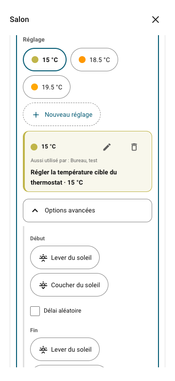
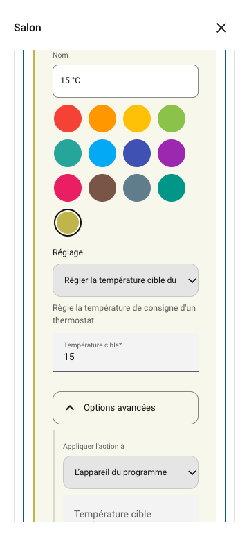

Français

# Reste de l’ancien guide, à répartir (non publié)

Ce fichier garde ce qui reste à écrire : les sections 5 à 7 du plan (`docs/PLAN_WIKI.md`). Les sections 2 (guide
« Je veux… »), 3 (`LEXIQUE.fr.md`, `PRIORITES.fr.md`) et 4 (`CARTE.fr.md`) sont écrites. Ce fichier attend d’être
réécrit, contre l’interface actuelle, puis il sera supprimé. Il n’est pas dans la barre latérale et aucune page n’y
renvoie. Ne rien y ajouter.

Où chaque bloc doit aller :

| Bloc ci-dessous | Section du plan |
|---|---|
| Délai aléatoire | 5.2 |
| Réglages : modifier, supprimer, valeur pour un appareil, position favorite, valeur d’une entité | 5.1 |
| Si une option du sélecteur change de nom | 5.6 |
| Fiche du programme | 5.4 / 5.5 |
| Pour la personne qui installe | 5.5, 5.6, 6.2, 6.5, 7.3 |

## Délai aléatoire

**Délai aléatoire (quelques minutes au hasard)** (sous **Options avancées**, pour le début et pour la fin) : cocher la case, puis
saisir **Délai maximum (minutes)**, de 1 à 240. L’action part chaque jour à un moment pris au hasard
dans ce délai ; une phrase donne la fenêtre calculée (« Dans les N prochaines minutes »). Il faut que l’horaire
garde au moins 5 minutes : sinon l’écran demande de réduire le délai ou d’allonger l’horaire.

## Réglages : modifier, supprimer, valeur pour un appareil

Dans le panneau **Réglages**, le bouton **Modifier** (le crayon) ouvre le réglage choisi.

Pour une exception, ouvrir un réglage existant avec le crayon (panneau **Réglages**), puis **Options avancées** :
**Valeur pour cet appareil** permet une autre valeur pour cet appareil seulement
([S13](SCREENS.fr.md#s13)). **Revenir à la valeur commune** enlève cette exception. Ces deux
choix n’existent que pour la modification d’un réglage déjà créé.

Pour supprimer un réglage, ouvrir le panneau **Réglages**, le choisir puis toucher la corbeille à côté du crayon. Une phrase demande
confirmation : **la suppression vaut pour tous les appareils**. Un réglage encore utilisé par un horaire ou un
programme ne peut pas être supprimé ; la phrase donne les noms des programmes à modifier d’abord.

Si un formulaire a des changements non enregistrés, ouvrir un autre panneau demande d’abord :
**Oui, les abandonner** les perd, **Non, continuer** les garde.

## Position favorite ou valeur qui change

Pour envoyer le volet vers sa position favorite, il faut une commande proposée
par Home Assistant. Si elle existe sous la forme d’un bouton, dans le réglage, ouvrir **Options avancées**
de l’éditeur d’action, puis :

1. Sous **Appliquer l’action à**, choisir **Une autre entité**.
2. Sous **Entité à commander**, choisir le bouton de position favorite.
3. Choisir son action pour l’appuyer.

Exemples : [bouton S42](SCREENS.fr.md#s42) et [valeur venant d’une entité S43](SCREENS.fr.md#s43).

Le nom du bouton dépend de votre installation. Il lance le déplacement ; il ne
sert pas à saisir une nouvelle position favorite.

Pour lire une température ou une position dans un réglage déjà présent : dans **Options avancées**
de l’éditeur d’action, choisir **Valeur d’une entité**, puis **Entité ou entrée à utiliser** et **Valeur à lire**.
Par exemple, une entrée de nombre peut contenir la température souhaitée.
La valeur est lue **quand l’horaire s’exécute**. Si elle n’est pas disponible,
l’action n’est pas envoyée. Choisir **Valeur fixe** pour saisir toujours le même
nombre. La personne qui prépare la carte peut aider à choisir la bonne entrée.

## Si une option du sélecteur change de nom

Si une seule option est renommée, les horaires suivent le nouveau nom dans tous
les programmes ; **Le mode X a été renommé en Y** s’affiche, dans l’écran des horaires
seulement, avec un bouton **Annuler** pendant une semaine et un bouton **OK** qui ferme
l’avis. Dans les autres cas, Weekly Planner ne devine pas : le mode sans option
garde ses horaires, marqué **n’existe plus** (« Le mode X n’existe plus dans la liste des
modes. »), et rien n’est effacé. L’écran des horaires propose chaque nouvelle option
(**Est-ce devenu… ?**) ou **Supprimer ses horaires**, et un message de **Réparations** de Home
Assistant le signale aussi.

## Fiche du programme

Le panneau **Weekly Planner** a trois rubriques : **Actions** (**Nouveau programme**, **Dupliquer un programme**,
**Ordre des priorités**) et la **Liste des programmes**. Ouvrir un programme montre sa **Fiche du programme** avec
deux onglets, **Général** et **Appareils**.

Dans **Général** : **Nom**, **Pièce (facultative)**, **Icône**, la **Priorité** (bloc « Partage un appareil avec N
programmes », voir [Priorités](PRIORITES.fr.md)), sous **Autres paramètres** **Renvoyer le réglage en cours après un
redémarrage ou un changement**, et **Conditions du programme**. **Supprimer ce programme** supprime le programme,
avec ses horaires. Dans **Appareils** : les appareils du programme et leurs **Actions proposées**. Les onglets se
parcourent aux flèches, avec Début et Fin.

**Attention aux deux enregistrements :** l’éditeur de la carte (Home Assistant) ne change que la présentation de cette
carte ; **Enregistrer** dans le panneau change le programme, sur toutes les cartes qui l’utilisent. Annuler l’éditeur
de carte **n’annule pas un programme déjà enregistré**. Avant d’enregistrer, **Annuler la modification** et **Refaire**
parcourent le brouillon. Ils ne reviennent pas sur un enregistrement déjà envoyé.

## Pour la personne qui installe

- **Actions proposées** (onglet **Appareils**) limite les choix de services. Les modes et favoris
  dépendent de ce que Home Assistant expose : [exemples](GENERIC_ACTIONS.md).
- **Renvoyer le réglage en cours** peut envoyer l’action courante après un changement ou un redémarrage.
  Les fins manquées restent un cas de rattrapage. Les identifiants internes des modes restent stables.
- Les options globales se trouvent dans Paramètres → Appareils et services →
  Weekly Planner → Configurer : [S35](SCREENS.fr.md#s35). L’option de réapplication
  par défaut donne la valeur de départ de **Renvoyer le réglage en cours** à chaque nouveau programme.
  Les autres options : **Seuls les administrateurs peuvent modifier les programmes**, l’alerte si un
  appareil est indisponible (1 à 1440 minutes) et le délai d’attente avant d’appliquer un changement de condition
  (0 à 60 minutes).
- Limites : nom de programme 60 caractères, de réglage 30, de mode 40 ; 20 modes par programme,
  50 horaires par jour, 100 appareils par programme, 10 conditions par horaire ;
  décalage solaire de −240 à +240 minutes ; délai aléatoire de 1 à 240 minutes ; nom affiché d’une source de
  graphique 60 caractères, 100 états mis en évidence.
- Notifications persistantes : « X est indisponible : son action planifiée est toujours en attente »,
  « X : … n’a pas pu être exécuté », et « Le fichier de configuration … n’a pas pu être lu »
  (les programmes sont alors en pause et rien n’est écrasé). Réparations de Home Assistant :
  entités supprimées, fichier YAML ignoré, modes devenus globaux, mode qui ne correspond à aucune option du sélecteur.
- Le fichier YAML `/config/www/weekly_planner.yml` est public : voir l’avertissement de la [référence](REFERENCE.fr.md#fichier-yaml).

[Voir tous les écrans dans l’atlas](SCREENS.fr.md)
