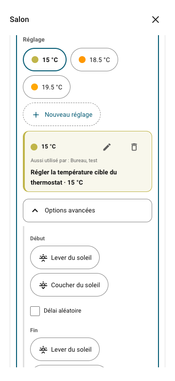

Français

# Les réglages et leurs actions

Testée avec la version 0.30.0. <!-- VERSION : numéro à confirmer à la publication -->

Un **réglage** donne un nom à ce que l’appareil doit faire : **Confort = 20 °C**, **Ouvert**, **Éco**… Les horaires
disent seulement *quand* l’utiliser. Cette page explique comment créer un réglage et choisir ce qu’il commande, puis
les options plus rares d’un horaire et d’un programme.

Sur cette page : [Créer et modifier un réglage](#créer-et-modifier-un-réglage) ·
[Ce que peut faire un réglage](#ce-que-peut-faire-un-réglage) ·
[Horaires aléatoires](#horaires-aléatoires) · [Soleil et limites](#soleil-et-limites) ·
[La fiche du programme et sa pièce](#la-fiche-du-programme-et-sa-pièce) ·
[Renvoyer, vérifier, réessayer](#renvoyer-vérifier-réessayer) ·
[Modes, lecture seule et limites](#modes-lecture-seule-et-limites).

## Créer et modifier un réglage

Les réglages sont **les mêmes pour tous les programmes** : un réglage créé pour le chauffage du salon est aussi
proposé aux autres programmes. Ils se gèrent dans la fenêtre des horaires, partie **Réglages**
([La carte](CARTE.fr.md#la-fenêtre-des-horaires)). Pour un premier réglage pas à pas : [Premier programme](PREMIER_PROGRAMME.fr.md) et
[Régler le matin et le soir](GUIDE_MATIN_ET_SOIR.fr.md).

1. Sur la carte, toucher **Modifier** à droite du programme, puis ouvrir **Réglages**.
2. Toucher **Nouveau réglage**. Saisir le **Nom** (30 caractères au plus), choisir la **Couleur du réglage**.
3. Sous **Que doit faire ce réglage ?**, choisir l’action, puis ses valeurs ([la suite](#ce-que-peut-faire-un-réglage)).
4. Toucher **Enregistrer** (ou **Annuler**).

Pour **modifier** un réglage, le choisir dans la liste puis toucher **Modifier** (le crayon). Un réglage utilisé par
plusieurs programmes le dit : **Attention : modifier ce réglage modifie aussi …** (suivi des noms).

Pour **supprimer** un réglage, le choisir puis toucher **Supprimer ce réglage** (la corbeille). La suppression vaut
pour tous les appareils. Si un programme utilise encore ce réglage, l’écran le dit (« … sert encore : … »)
et propose **Le remplacer partout par :** un autre réglage, puis **Remplacer et supprimer**. Rien n’est supprimé à
moitié : si un programme ne peut pas être changé, le réglage reste.

Si un formulaire a des changements non enregistrés et que vous en ouvrez un autre, l’écran demande d’abord :
**Oui, les abandonner** ou **Non, continuer**.

Quand le programme est en lecture seule, ou quand le mode ouvert n’est pas le mode actif, les boutons restent
affichés, grisés, avec la raison écrite ([Qui peut modifier quoi](CONFIGURATION.fr.md#qui-peut-modifier-quoi)).

## Ce que peut faire un réglage

La liste **Action** ne propose que des choses que Home Assistant sait faire avec l’appareil : ses services (régler
une température, une position, allumer, éteindre…) et les scènes qui le contiennent. Weekly Planner n’a pas de liste
d’appareils ou de marques : ce que Home Assistant propose pour votre appareil est ce que vous voyez.

### Choisir les actions proposées

Dans la **Fiche du programme**, onglet **Appareils**, **Actions proposées** limite les actions à celles que vous
cochez pour chaque appareil. Un appareil ajouté n’a encore aucune action cochée : il faut cocher celles qui sont
utiles (la liste se déplie toute seule à la création), et on peut les changer ensuite. Les scènes ne dépendent pas
de cette liste. Si la liste est vide ou s’il manque une action, le réglage dit : « Choisissez d’abord les actions à
proposer dans Fiche du programme → Appareils. » Seuls les champs que l’appareil prend en charge sont affichés.

### Le thermostat : un préréglage ou une température

Pour une température, choisir l’action qui règle la température, puis saisir la valeur (**Confort = 20 °C**).
Pour un préréglage du thermostat, cocher son action de préréglage dans **Actions proposées**, puis créer un réglage
avec cette action : la liste des préréglages vient de l’appareil lui-même. Si votre thermostat n’expose pas
« Éco » ou « Confort », ils n’apparaissent pas : Weekly Planner n’en invente aucun. Le mode de chauffage
(chauffer, refroidir, arrêt) est une autre action, avec sa propre liste.

Sous le **Nom**, la case **Afficher la valeur après le nom** (visible pour un préréglage ou une valeur lue sur une
entité) ajoute la valeur au nom affiché : « Favori (40 %) ».

### Envoyer le volet à sa position favorite

Un bouton « position favorite » lance un déplacement ; il ne dit pas à quel pourcentage il arrive. Pour l’utiliser
tout en gardant le volet dans le programme :

1. Dans **Actions proposées** du volet, cocher l’action des boutons (appuyer sur un bouton).
2. Créer un réglage, par exemple **Favori**. Ouvrir **Options avancées** de l’éditeur d’action, puis, sous
   **Appliquer l’action à**, choisir **Une autre entité**.
3. Sous **Entité à commander**, choisir le bouton de position favorite, puis son action d’appui.
4. Dans l’horaire, choisir **À cette heure seulement** : le bouton est pressé une fois.

Le nom du bouton dépend de votre installation. Une position fixe, elle, envoie un pourcentage : elle ne rappelle
pas la position mémorisée par le moteur. Si Home Assistant n’offre aucune action pour cela, Weekly Planner ne peut pas
en inventer une. Exemples à l’écran : [bouton S42](SCREENS.fr.md#s42).

### Lire la valeur dans une autre entité

Exemple réel : la température de confort de toute la maison se règle depuis le tableau de bord, sans ouvrir les
programmes. Créer une entrée de nombre (`input_number.temperature_confort`), puis dans le réglage **Confort** :

1. Ouvrir **Options avancées** de l’éditeur d’action.
2. Pour le champ de la température, choisir **Valeur d’une entité** au lieu de **Valeur fixe**.
3. Sous **Entité ou entrée à utiliser**, choisir l’entrée de nombre ; sous **Valeur à lire**, **État de l’entité**
   (ou un de ses attributs).

L’écran montre **Valeur actuelle : …**. La valeur est lue **quand l’horaire s’exécute**. Si elle est indisponible,
l’action n’est pas envoyée et il n’y a pas de valeur de remplacement. Changer l’entrée ne déclenche pas d’action
tout seul : le nouveau chiffre sert au prochain envoi. Cet exemple en [S43](SCREENS.fr.md#s43).

### Une valeur pour un seul appareil

Quand un programme a plusieurs appareils, un réglage peut avoir une autre valeur pour l’un d’eux. Ouvrir le réglage
avec **Modifier**, puis **Options avancées** : **Valeur pour cet appareil** (suivi du nom de l’appareil) ouvre les
mêmes choix. **Revenir à la valeur commune** enlève l’exception. Ces deux choix n’existent que pour un réglage déjà
créé.

### Activer une automatisation pendant une plage horaire

Exemple réel : l’alerte « porte du garage ouverte » ne doit être active que la nuit, de 22 h à 6 h.

1. Ajouter l’automatisation comme appareil du programme et cocher dans **Actions proposées** les actions pour
   l’activer et la désactiver.
2. Créer deux réglages, **Alerte active** et **Alerte coupée**, avec ces deux actions.
3. Choisir **Alerte coupée** pour **Le reste du temps** ([Régler le matin et le soir](GUIDE_MATIN_ET_SOIR.fr.md)).
4. Ajouter l’horaire de 22 h à 6 h avec **Alerte active**.

Cela active ou coupe les déclencheurs de l’automatisation ; cela ne la lance pas. Lancer l’automatisation à l’heure
voulue est une autre action (« déclencher »).

### Lancer une suite d’actions avec des pauses

Un horaire envoie **une seule action à un appareil**. Pour une suite avec des attentes (exemple réel : à 7 h 39
allumer l’ampli, une minute plus tard régler le volume et lancer la radio), la suite vit dans un **script** de Home
Assistant, et le programme le lance :

1. Dans Home Assistant, créer le script (`script.reveil_musique`) avec ses actions et ses `delay`. Un champ de texte
   libre, comme le nom d’une liste de lecture, reste dans le script.
2. Dans le programme, ajouter le script comme appareil et cocher dans **Actions proposées** l’action qui le lance.
3. Créer un réglage qui lance le script, sans heure de fin (**À cette heure seulement**).
4. Ajouter un horaire à 7 h 39 pour les jours voulus.

Weekly Planner ne fait que lancer le script. Ensuite la suite appartient à Home Assistant : la carte ne la montre pas
pas à pas, elle n’est pas interrompue quand le programme est arrêté ou que le mode change, et le réglage `mode` du
script (`single`, `restart`, `queued`) décide de ce qui se passe si on la relance. Weekly Planner n’ajoute aucun droit
([Qui peut modifier quoi](CONFIGURATION.fr.md#qui-peut-modifier-quoi)).

## Horaires aléatoires

Pour qu’une lumière de présence ne s’allume pas à la seconde près chaque soir, ou que des volets ne bougent pas
tous ensemble.

1. Dans le formulaire d’horaire, sous **Début** (ou sous **Fin**), ouvrir **Options avancées**.
2. Cocher **Délai aléatoire (quelques minutes au hasard)**. Le délai maximum est au départ de 15 minutes.
3. Saisir **Délai maximum (minutes)**, de 1 à 240.

Chaque jour, l’action part à un moment pris au hasard entre l’heure réglée et cette heure plus le délai. Une phrase
l’écrit en toutes lettres (« Chaque jour, démarre au hasard entre 18 h et 18 h 15 »). Cela marche pour une heure fixe
comme pour le lever ou le coucher du soleil ; avec une limite d’heure (**Au plus tard à**), la limite coupe le
délai. Sur la carte, la liste des horaires dit **heure variable, quelques minutes d’écart**.

Quand l’horaire a une heure de fin fixe, après le délai du début il doit rester au moins 5 minutes. Sinon l’écran
dit : « Réduisez le délai aléatoire ou allongez cet horaire : il doit rester au moins 5 minutes. »

## Soleil et limites

**Lever du soleil** et **Coucher du soleil**, le décalage (de −240 à +240 minutes, par pas de 15 avec **−** et **+**)
et les limites **Au plus tôt à** et **Au plus tard à** (la case **Pas avant / pas après une heure fixe**) sont
expliqués pas à pas dans [Suivre le soleil](GUIDE_SOLEIL.fr.md). Elles sont au même endroit que le délai aléatoire :
sous **Options avancées** de **Début** et de **Fin**, chacun avec son réglage. L’heure du soleil est celle du lieu
enregistré dans Home Assistant.

## La fiche du programme et sa pièce

Dans le panneau **Weekly Planner** (**Liste des programmes**), ouvrir un programme montre sa **Fiche du programme**,
avec deux onglets, **Général** et **Appareils** (les flèches du clavier passent de l’un à l’autre, avec Début et Fin).

| Où | Ce qu’on y règle |
|---|---|
| **Général** : **Nom**, **Icône** | Le nom du programme ; l’icône du premier appareil est utilisée tant qu’on n’en choisit pas une autre. |
| **Général** : **Pièce (facultative)** | Un nom pour regrouper les programmes dans les filtres de la carte et du panneau. |
| **Général** : **Priorité** | Qui commande quand deux programmes visent le même appareil : [Priorités](PRIORITES.fr.md). |
| **Général** : **Autres paramètres** | **Renvoyer le réglage en cours après un redémarrage ou un changement** ([la suite](#renvoyer-vérifier-réessayer)). |
| **Général** : **Conditions du programme** | Le programme ne marche que si toutes les conditions sont vraies ([Lexique](LEXIQUE.fr.md#conditions)). |
| **Appareils** | Les appareils du programme et leurs **Actions proposées** ([plus haut](#choisir-les-actions-proposées)). |
| **Supprimer ce programme** | Supprime le programme et tous ses horaires, après confirmation. |

La **Pièce** est un simple nom : c’est la liste des pièces de Home Assistant et celles déjà utilisées par vos
programmes, plus **Autre pièce…** pour en écrire une nouvelle, et **Aucune pièce**. Elle ne lit pas les pièces de
vos appareils : un programme n’a que la pièce que vous lui donnez. Le filtre **Pièce** de la carte
([Changer la présentation](GUIDE_PRESENTATION.fr.md)) et le tri **Pièce (puis A→Z)** s’en servent.

**Attention aux deux enregistrements.** L’éditeur de la carte (Home Assistant) ne change que ce que cette carte
montre. **Enregistrer** dans le panneau change le programme, sur toutes les cartes qui le montrent ; **Annuler** dans
l’éditeur de la carte ne revient donc pas sur un programme déjà enregistré. Avant d’enregistrer, **Annuler la
modification** et **Refaire** parcourent le brouillon ; ils ne reviennent pas sur un enregistrement déjà envoyé.

## Renvoyer, vérifier, réessayer

**Renvoyer le réglage en cours.** Dans **Général → Autres paramètres**, la case **Renvoyer le réglage en cours après
un redémarrage ou un changement** fait renvoyer à l’appareil ce qu’il doit faire à ce moment-là : après un
redémarrage de Home Assistant (au bout de 30 secondes de calme), quand on remet le programme en marche ou quand on
modifie ses horaires. Décochée : rien n’est envoyé avant le prochain changement d’horaire. Les fins d’horaire manquées
sont rattrapées dans tous les cas. La case de départ de chaque **nouveau** programme est une
[option de l’intégration](CONFIGURATION.fr.md#réglages-de-lintégration). Pour tout remettre d’aplomb à la main :
[Après une panne](GUIDE_APRES_PANNE.fr.md).

**Vérifier.** Quand l’action fixe une valeur que l’appareil peut relire (une température, une position, un
préréglage), Weekly Planner relit l’appareil environ 8 secondes après l’envoi. Une scène ou une commande sans valeur
(ouvrir, fermer, allumer) n’est pas vérifiée.

- Si l’appareil n’a pas pris la valeur, il la renvoie au prochain changement d’état de l’appareil, au plus une fois
  par minute et 10 fois au plus. L’attribut `verification` de l’interrupteur du programme indique alors `pending` pour cet appareil ([Entités](ENTITES_SERVICES.fr.md#entités)).
- Si l’appareil s’est mis ailleurs de lui-même, c’est considéré comme un choix d’une personne : rien n’est forcé
  (`manual`).
- Après une reprise réussie : `ok`.

**Réessayer.** Si Home Assistant refuse un envoi, il est refait après 1, 2, 5, 10 puis 15 minutes. Si tout a échoué,
une notification dit « … : … n’a pas pu être exécuté. » Un appareil **indisponible** reçoit son réglage dès qu’il
revient ; s’il reste indisponible plus longtemps que le délai des [options](CONFIGURATION.fr.md#réglages-de-lintégration),
une notification le dit ([Notifications et réparations](ENTITES_SERVICES.fr.md#notifications-et-réparations)).

## Modes, lecture seule et limites

**Renommer une option du sélecteur de mode.** Si une seule option est renommée, les horaires suivent le nouveau nom
dans tous les programmes. L’avis **Le mode X a été renommé en Y** s’affiche, dans l’écran des horaires seulement,
avec un bouton **Annuler** pendant une semaine et un bouton **OK** qui ferme l’avis. Il faut pour cela que le
sélecteur garde le même nombre d’options dans le même ordre et qu’un seul nom change.

**Un mode qui n’a plus d’option.** Dans les autres cas, Weekly Planner ne devine pas : le mode sans option garde ses
horaires, marqué **n’existe plus** (« Le mode X n’existe plus dans la liste des modes. »), il n’est jamais utilisé et
rien n’est effacé. L’écran des horaires propose chaque nouvelle option (**Est-ce devenu… ?**) ou **Supprimer ses
horaires**, et une réparation de Home Assistant le signale aussi. Tant que vous n’avez pas répondu, rien ne change.

**Un mode sans horaires.** Un programme qui n’a aucun horaire pour le mode actif affiche **Aucun horaire pour ce
mode** : ses appareils suivent **Le reste du temps**. Un mode vide ne veut donc pas dire « éteint »
([Des horaires selon le mode](GUIDE_MODES.fr.md)).

**Lecture seule.** Quand vous n’avez pas le droit de modifier, ou quand le mode ouvert n’est pas le mode actif, les
boutons de modification restent affichés, grisés, avec une phrase qui dit pourquoi : **Lecture seule**,
**Ce n’est pas le mode actif.**, **Terminez d’abord l’horaire.**…

**Limites.**

| Quoi | Limite |
|---|---|
| Nom d’un programme, d’un réglage, d’un mode | 60, 30 et 40 caractères |
| Modes par programme | 20 |
| Horaires par jour | 50 |
| Appareils par programme | 100 |
| Conditions d’un horaire (fichier YAML seulement : le formulaire n’en propose pas) | 10 |
| Décalage du soleil | de −240 à +240 minutes |
| Délai aléatoire | de 1 à 240 minutes |
| Sources du graphique | nom affiché de 60 caractères au plus, 100 états mis en évidence |

[Accueil](ACCUEIL.fr.md) · [Guide : je veux…](GUIDE.fr.md) · [Configuration](CONFIGURATION.fr.md)
