# Atlas des écrans

[Lire le guide pas à pas](GUIDE.fr.md)

Les captures montrent des programmes et des appareils de démonstration.

Les captures principales sont prises sur un téléphone de **360 × 780 pixels CSS**,
en thème clair, sauf la fenêtre agrandie sur ordinateur. Cliquer sur une miniature
permet d’ouvrir l’image complète. Les écrans longs disposent de captures de suite.

## Création, pièce, filtres et graphique

### S37 — Créer un programme

Donner un nom, ajouter un appareil, puis cocher les commandes utiles. Aucune commande n’est sélectionnée au départ.

<a href="images/guide/s37-create-actions.png">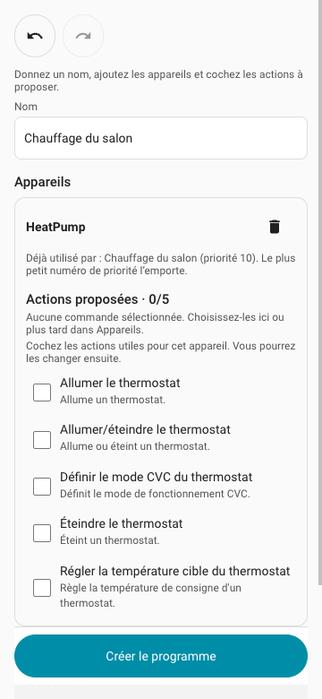</a>

### S38 — Choisir ou préparer un mode

Le mode se choisit en dehors de Weekly Planner. Les horaires de chaque mode se préparent dans l’écran des horaires, avec la liste **Mode** en haut ; l’onglet **Modes** des réglages du programme y renvoie par **Modifier les horaires de ce mode**.

<a href="images/guide/s38-modes-manual.png">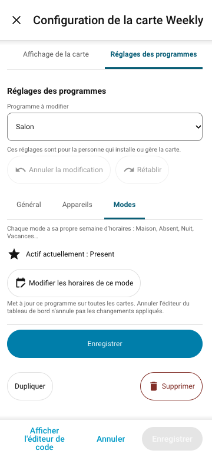</a>

### S39 — Choisir l’entité qui donne le mode

Le sélecteur de mode se règle une fois dans les options de l’intégration ([S35](#s35)) et ses options sont les modes. Une entité qui change d’état, comme un capteur, ne donne pas le mode directement : une automatisation change le sélecteur ([recettes](MODES_COOKBOOK.fr.md)).

<a href="images/guide/s39-modes-external.png">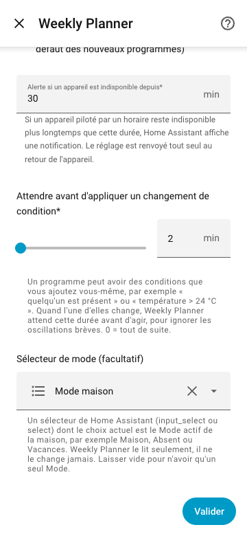</a>

### S40 — Pièce du programme

Définir la pièce dans Général (« Pièce du programme ») puis Appliquer au programme. Elle ne vient pas automatiquement des pièces des appareils.

<a href="images/guide/s40-program-area.png">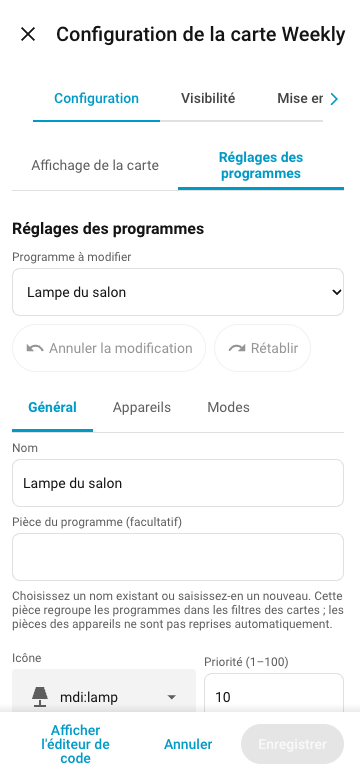</a>

### S41 — Filtres et présentation

Choisir la pièce, les programmes à afficher et la présentation de la journée. Les interrupteurs « Bouton Graphique sous chaque appareil » et « Graphique ouvert d’office » règlent le graphique.

<a href="images/guide/s41-card-filter.png">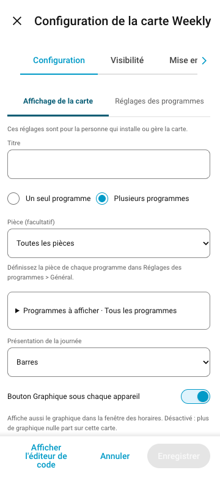</a>

### S42 — Appuyer sur un autre bouton

Fragment du réglage d’action. Le bouton de test s’appelle Push ; choisir le vrai bouton de position favorite de son installation. Aucune commande n’a été exécutée.

<a href="images/guide/s42-action-target.png">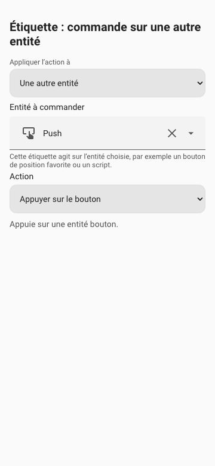</a>

### S43 — Lire une valeur dans une entité

Fragment du réglage d’action. Ici temperature est la consigne du thermostat de démonstration, pas sa température mesurée. La valeur sera lue au moment de l’exécution.

<a href="images/guide/s43-action-source.png">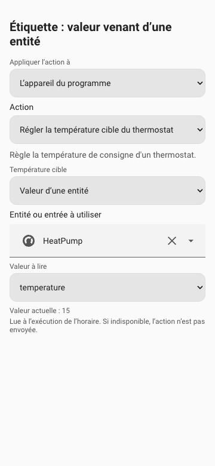</a>

### S44 — Double cadran de 12 heures

Fragment du cadran. Intérieur : 0–12 h ; extérieur : 12–24 h. Confort : 6 h 30–8 h 30 et 17–22 h. Le gris indique ici qu’aucune action n’est prévue.

<a href="images/guide/s44-radial-double.png">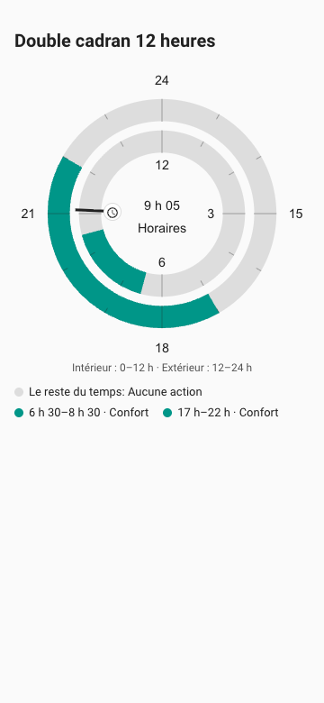</a>

### S45 — Graphique sans données

Fragment du graphique pour une journée future sans horaires. Les messages distinguent l’historique futur de l’absence d’action prévue.

<a href="images/guide/s45-chart-empty.png">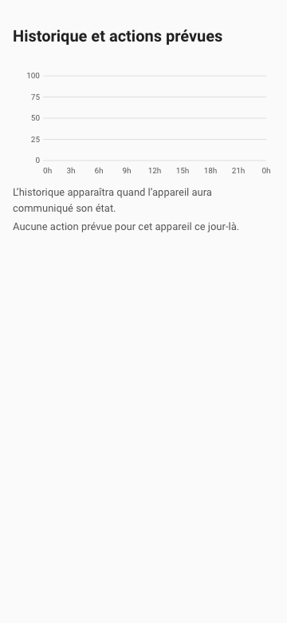</a>

## Autres écrans

## S01 — Vue d’ensemble

Les programmes du salon montrent leur état, leur prochaine action, leur interrupteur et la barre du jour ; le bouton **Graphique du jour** est ouvert sous la lampe.

<a href="images/guide/s01-overview.png">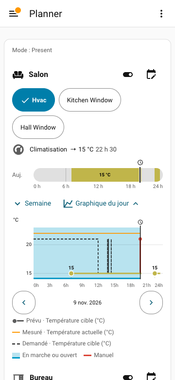</a>

## S02 — Un seul programme

Une carte fixée sur le chauffage du salon donne accès à ses horaires sans passer par une liste de tous les réglages ; les réglages se modifient dans la fenêtre des horaires.

<a href="images/guide/s02-one-program.png">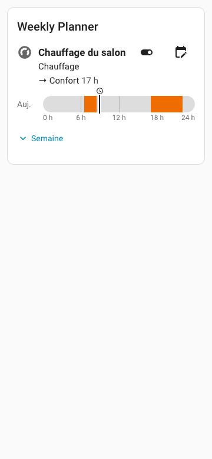</a>

## S03 — Cadran de 24 heures

Le cadran présente les horaires du jour et leur légende. Un clic ou un appui long permet de modifier les arcs avec leurs poignées.

<a href="images/guide/s03-radial.png">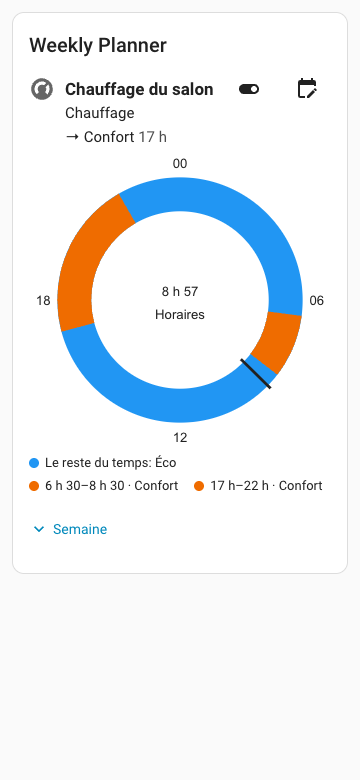</a>

## S04 — Liste compacte

La liste rassemble les programmes, leurs prochaines actions et leurs interrupteurs dans des lignes courtes.

<a href="images/guide/s04-compact-list.png">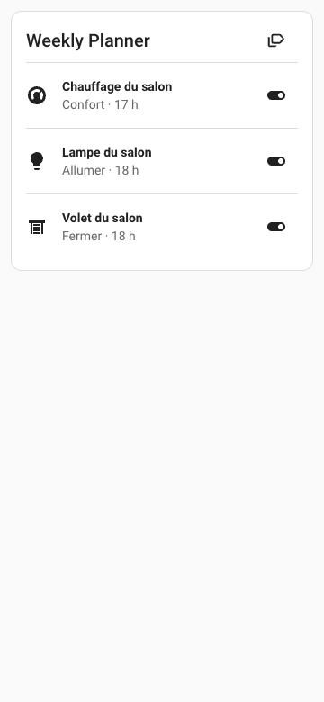</a>

## S05 — Semaine dépliée

Le bouton Semaine affiche les sept jours. Le nom d’un jour ouvre ses horaires.

<a href="images/guide/s05-week-expanded.png">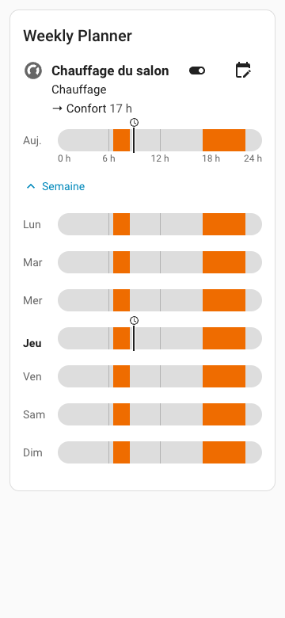</a>

## S06 — Tous les horaires

La fenêtre des horaires rassemble l’interrupteur **Programme actif**, le cadre **Mode** (avec un sélecteur de mode), le cadre **Horaires** (la ligne **Le reste du temps** au-dessus de la liste des horaires, puis la section repliable **Jour férié** quand une entité jour férié est réglée) et le schéma de la semaine ; quand le jour férié du mode est activé, une ligne **Férié** y montre ses horaires sous le dimanche.

<a href="images/guide/s06-schedules.png">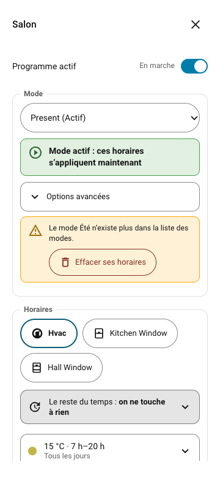</a>

## S07 — Horaires d’un jour

Le jour sélectionné limite la liste affichée. Le retour à la semaine permet de retrouver l’ensemble.

<a href="images/guide/s07-one-day.png">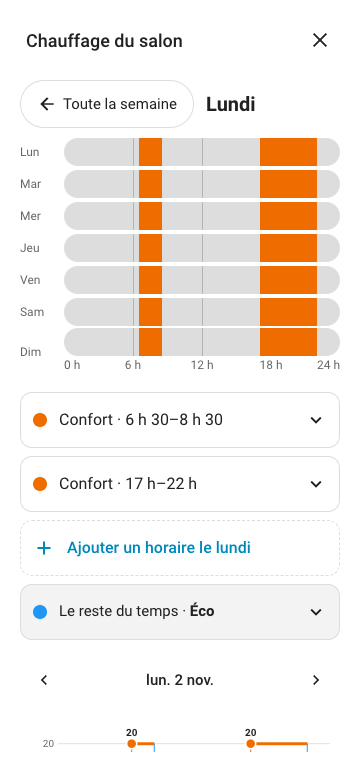</a>

## S08 — Modifier un horaire

Le formulaire contient le début, la fin facultative, les jours (avec **En semaine** et **Week-end**), le **Réglage** et le repli **Options avancées**. La suite de la capture montre les contrôles placés plus bas.

<a href="images/guide/s08-slot-form.png">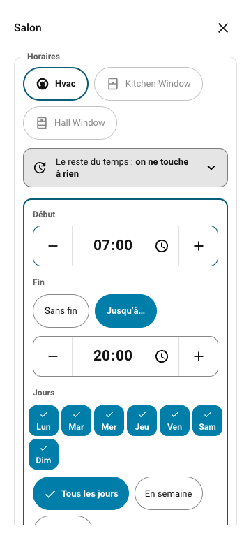</a>

Suite de l’écran :

<a href="images/guide/s08-slot-form-suite.png">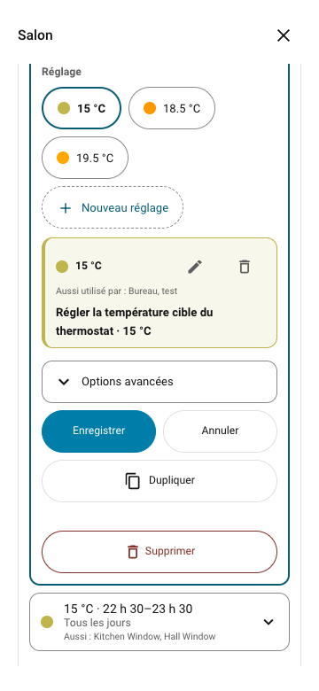</a>

## S09 — Utiliser le soleil

Dans **Options avancées**, les choix Lever et Coucher remplacent l’heure fixe par un événement solaire. Les boutons − et + changent son décalage. Les champs facultatifs **Au plus tôt à** et **Au plus tard à** empêchent l’heure de sortir de ces limites ; une phrase dessous donne l’heure réelle (« coucher du soleil + 30 min, mais pas avant 18:00 ni après 19:00 ») et le résultat d’aujourd’hui.

<a href="images/guide/s09-solar-slot.png">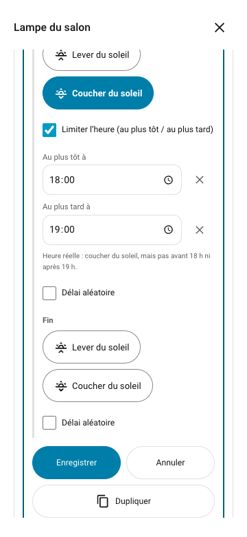</a>

## S10 — Action sans fin

Sans fin crée une action ponctuelle : elle est lancée au début, sans retour automatique à « Le reste du temps ».

<a href="images/guide/s10-one-shot.png">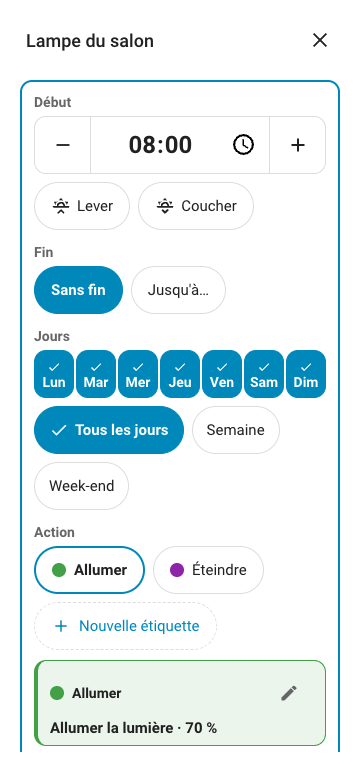</a>

## S11 — Créer un réglage

Le formulaire intégré (**Nouveau réglage**) définit le nom, la couleur et l’action. L’enregistrement se fait avec celui de l’horaire.

<a href="images/guide/s11-new-label.png">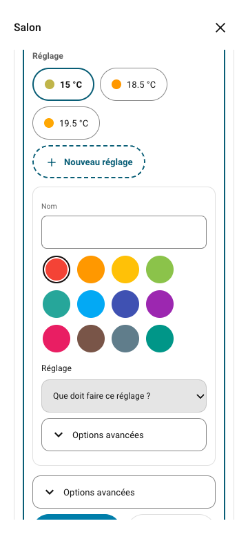</a>

## S12 — Modifier un réglage partagé

Le crayon ouvre le réglage sélectionné. La mention « Aussi utilisé par : » nomme les autres programmes qu’une modification concernerait. La corbeille voisine supprime le réglage pour tous les appareils après confirmation ; elle est refusée, avec les noms des programmes concernés, tant que le réglage sert.

<a href="images/guide/s12-edit-shared-label.png">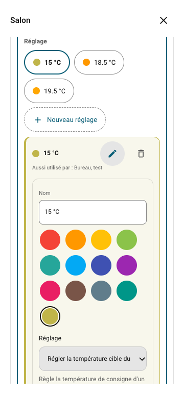</a>

## S13 — Valeur propre à un appareil

Une valeur propre adapte l’action pour cet appareil. Revenir à la valeur commune supprime cette exception.

<a href="images/guide/s13-device-value.png">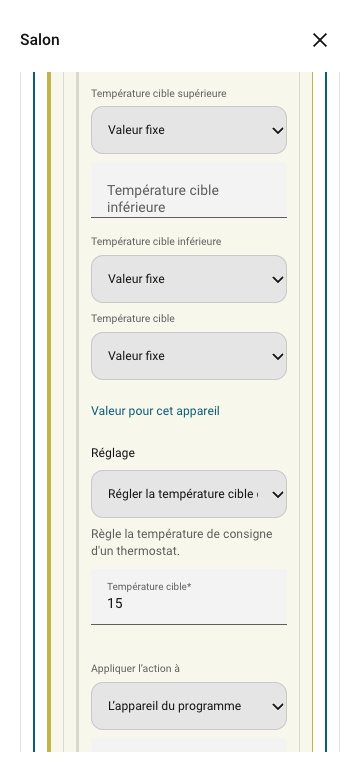</a>

## S14 — Le reste du temps

Cette ligne, au-dessus de la liste des horaires, définit l’action du reste du temps de l’appareil. Laisser tel quel signifie qu’aucune action n’est envoyée à la fin d’un horaire.

<a href="images/guide/s14-rest-of-time.png">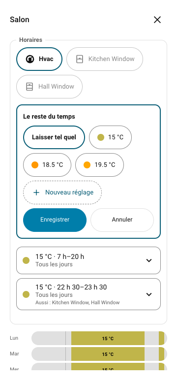</a>

## S15 — Graphique du jour

Le bouton **Graphique du jour** ouvre le graphique sous l’appareil, avec sa légende (**Prévu**, **Mesuré**, **Demandé**, avec la grandeur de l’appareil). Le graphique rapproche les actions prévues et l’historique disponible ; une bande colorée marque les moments où l’appareil était en marche (ou le volet ouvert).

<a href="images/guide/s15-chart.png">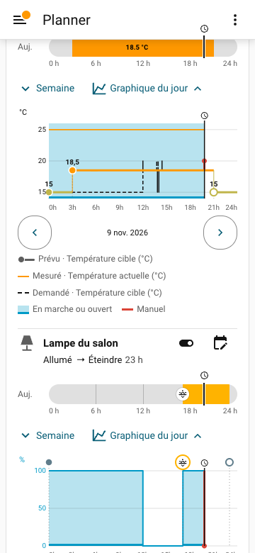</a>

## S16 — Historique Home Assistant

Un toucher du graphique ouvre l’historique natif de l’entité dans Home Assistant.

<a href="images/guide/s16-ha-history.png">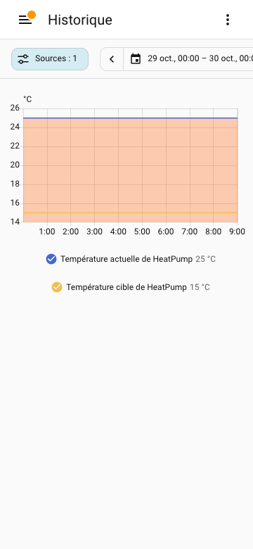</a>

## S17 — Fenêtre agrandie sur ordinateur

Le bouton **Agrandir / réduire** (flèches, à côté de la croix) élargit la fenêtre. Sur téléphone, la fenêtre utilise déjà tout l’écran.

<a href="images/guide/s17-expanded-dialog.png">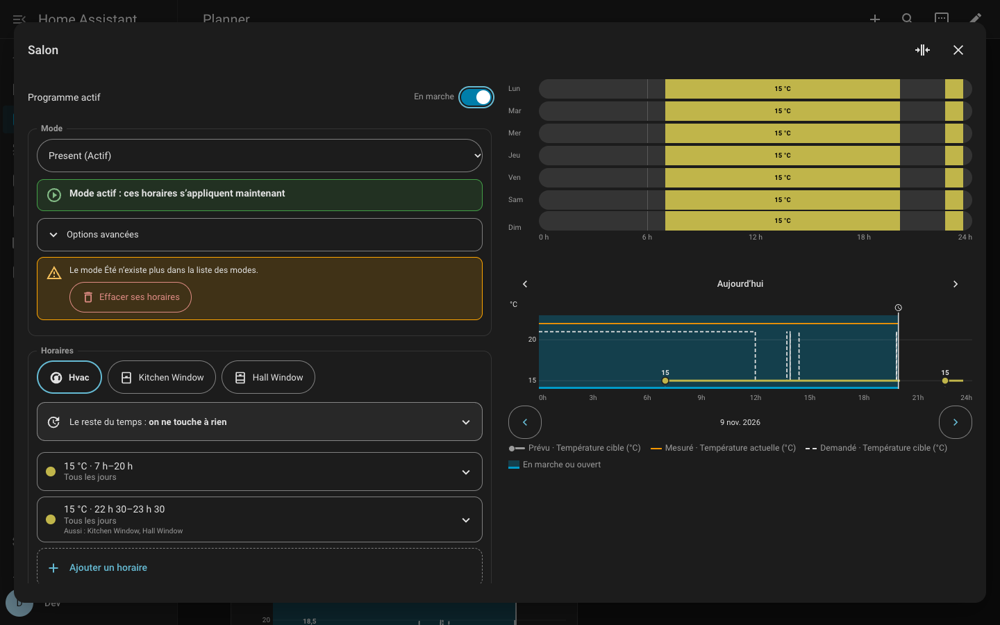</a>

## S18 — Édition directe sur une barre

Un clic à la souris ou un appui long au doigt affiche les poignées et les actions de l’horaire sélectionné : **Couper en deux**, **Copier sur d’autres jours**, **Effacer** et le choix du réglage.

<a href="images/guide/s18-bar-edit.png">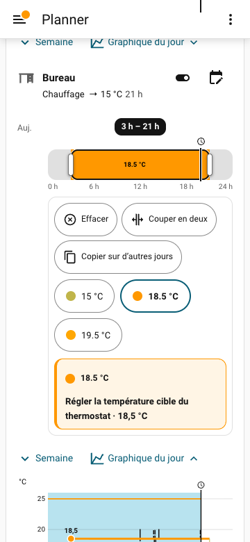</a>

## S19 — Copier sur d’autres jours

Choisir les jours de destination prépare la copie de l’horaire sélectionné.

<a href="images/guide/s19-copy-days.png">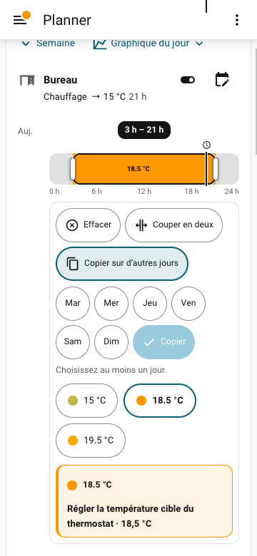</a>

## S20 — Chevauchement lors d’une copie

Les aperçus Avant et Après montrent le résultat. Chaque jour en conflit peut être remplacé ou exclu de la copie.

<a href="images/guide/s20-copy-conflict.png">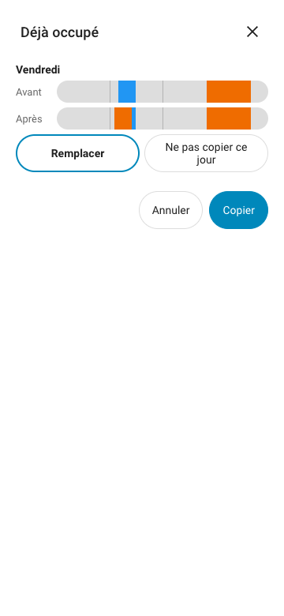</a>

## S21 — Annuler une modification de barre

Après l’enregistrement au relâcher, le bandeau Enregistré · Annuler permet de revenir brièvement en arrière.

<a href="images/guide/s21-bar-undo.png">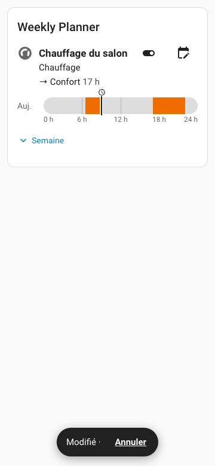</a>

## S24 — Affichage : liste filtrée

Choix de la pièce, présentation de la journée et réglages du graphique pour « Plusieurs programmes ».

<a href="images/guide/s24-card-filter-settings.png">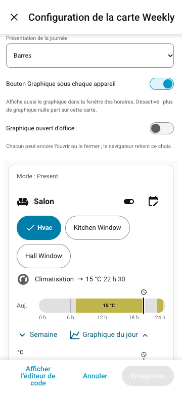</a>

## S25 — Affichage : un programme

Le programme fixé à la carte peut être présenté en barres, en cadran de 24 heures ou en liste compacte.

<a href="images/guide/s25-card-one-settings.png">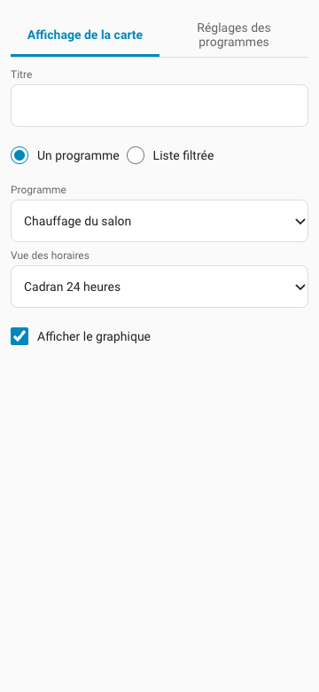</a>

## S26 — Choisir le programme à configurer

Le menu est fermé sur cette capture. Son ordre est Choisir un programme, Nouveau programme, puis les programmes existants, avec des séparateurs.

<a href="images/guide/s26-program-selector.png">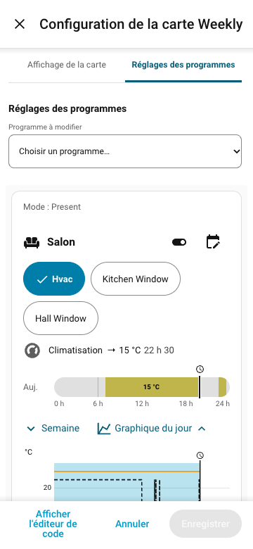</a>

## S27 — Créer un programme

Choisir les appareils avant l’icône. Les réglages ne sont envoyés qu’avec Appliquer au programme.

## S28 — Réglages généraux et historique local

Les boutons Annuler la modification et Rétablir parcourent le brouillon local. Les avertissements indiquent les autres programmes utilisant les appareils sélectionnés.

<a href="images/guide/s28-program-general-history.png">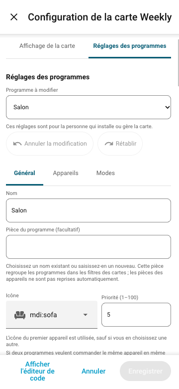</a>

## S29 — Conditions du programme

Une condition compare l’état ou un attribut d’une entité. Toutes les conditions du programme doivent être satisfaites pour ses horaires.

<a href="images/guide/s29-program-conditions.png">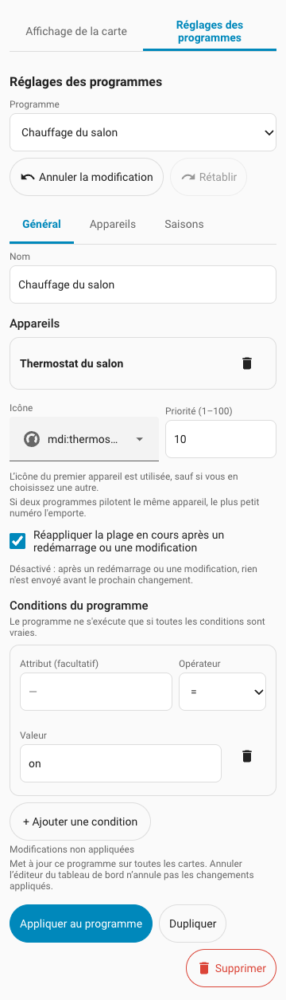</a>

## S30 — Actions proposées par appareil

La liste limite les services proposés pour cet appareil. Toutes signifie que les actions compatibles restent disponibles.

<a href="images/guide/s30-device-actions.png">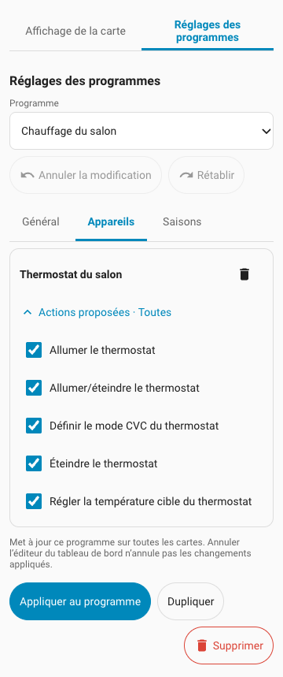</a>

## S31 — Gérer les modes

Les modes sont les options du sélecteur. Sous **Options avancées** de l’écran des horaires se trouvent « Reprendre les horaires d’un autre mode » (copie) et « Mêmes horaires que » (le mode suit un autre mode : ses horaires restent partagés jusqu’à **Arrêter de suivre**).

<a href="images/guide/s31-season-management.png">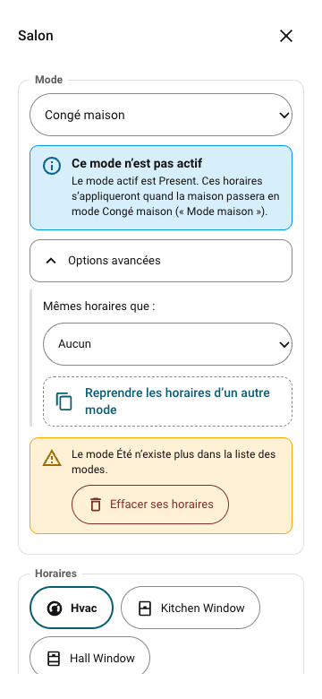</a>

## S32 — Nom de mode

Un nom de mode ne se saisit pas : il vient de l’option du sélecteur. Un mode qui n’est plus une option est marqué « n’existe plus » ; l’écran des horaires propose alors la nouvelle option (**Est-ce devenu… ?**) ou **Effacer ses horaires**.

<a href="images/guide/s32-season-name-draft.png">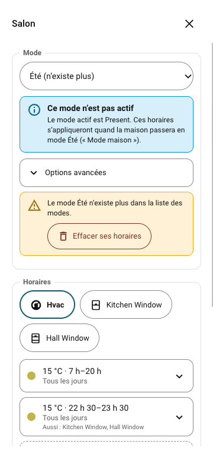</a>

## S33 — Changer le mode actif

Le programme n’a pas de sélecteur propre. Pour changer de mode, utiliser le sélecteur Home Assistant choisi dans les options de l’intégration.

<a href="images/guide/s33-active-season-ha.png">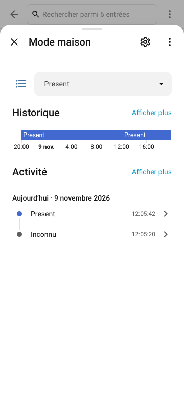</a>

## S34 — Confirmation

Les opérations concernées demandent confirmation, avec les boutons **Oui, supprimer** et **Non, garder**. Cette capture montre la boîte avant toute validation.

<a href="images/guide/s34-confirmation.png">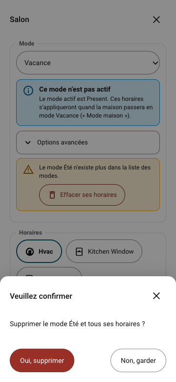</a>

## S35 — Options de l’intégration

Ces options Home Assistant concernent l’intégration entière : droits d’édition, sélecteur de mode (puis mode par défaut), réapplication par défaut, notifications et délai des conditions.

<a href="images/guide/s35-integration-options.png">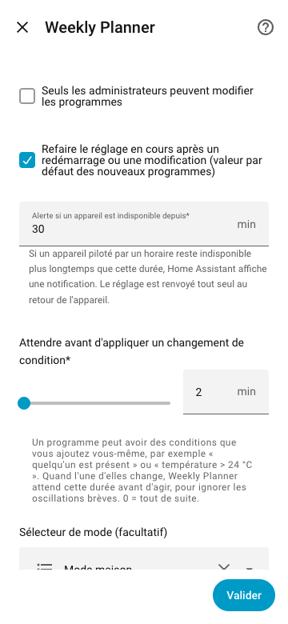</a>

## S36 — Une seule intégration suffit

Home Assistant refuse une seconde configuration de Weekly Planner. Pour ajouter un programme, utiliser Réglages des programmes dans la carte ; il n’est pas nécessaire d’ajouter une autre intégration.

<a href="images/guide/s36-single-instance.png">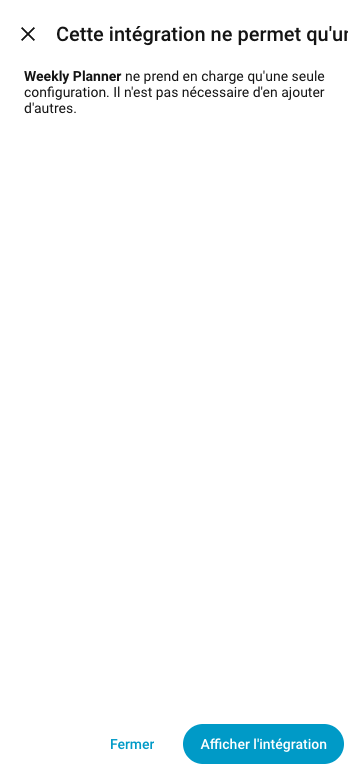</a>

## Pause, onglets, modes et notices

### S46 — Fenêtre Pause

La fenêtre **Pause** demande **Jusqu’à quand ?** avec deux choix, **Jusqu’à la reprise** et **Pour une durée**. Avec **Pour une durée**, vous choisissez **1 heure**, **1 jour** ou **7 jours**, ou vous remplissez les champs **Nombre d’heures** et **Nombre de jours**, puis **Confirmer**.

<a href="images/guide/s46-pause-dialog.png">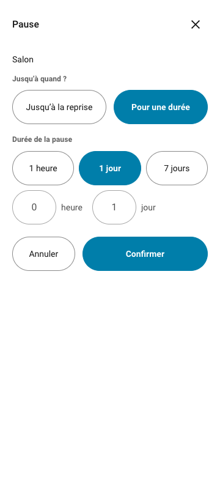</a>

### S47 — Carte avec onglets d’appareils

Sur la carte, un seul appareil est affiché à la fois ; des onglets permettent de passer de l’un à l’autre. La ligne **Mode : …** en haut indique le mode actif de la maison.

<a href="images/guide/s47-device-tabs.png">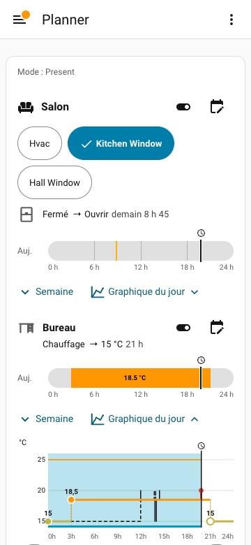</a>

### S48 — Liste des modes de l’écran des horaires

La liste **Mode** de l’écran des horaires montre un mode qui a les mêmes horaires qu’un autre (**Mêmes horaires que :**, sous **Options avancées**) et la notice **Ce mode n’est pas actif** quand les horaires affichés ne sont pas ceux du mode actuel de la maison.

<a href="images/guide/s48-mode-select.png">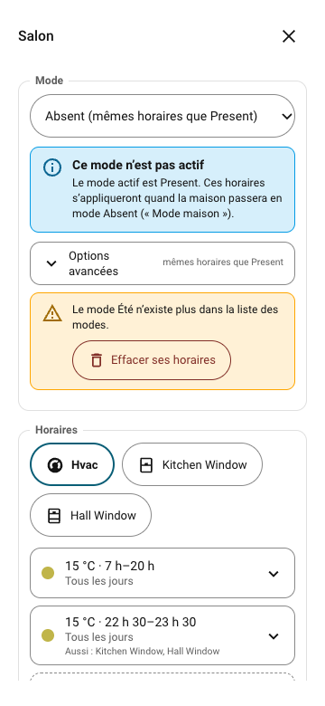</a>

### S49 — Éditeur d’horaire avec les options avancées

L’éditeur d’horaire avec le repli **Options avancées** ouvert : lever ou coucher du soleil, limite d’heure (**Limiter l’heure (au plus tôt / au plus tard)**) et **Délai aléatoire**.

<a href="images/guide/s49-advanced-options.png">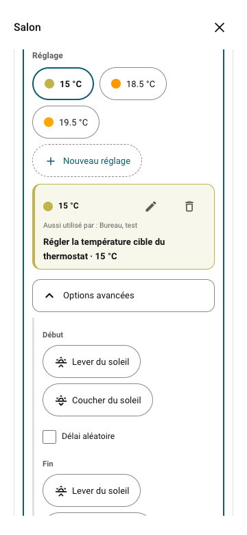</a>

### S50 — Éditeur d’un réglage

L’éditeur d’un réglage (nom, couleur, réglage à appliquer) avec ses **Options avancées** ouvertes.

<a href="images/guide/s50-setting-editor.png">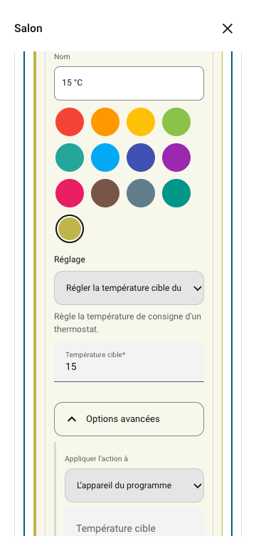</a>

### S51 — Les trois sortes de notice côte à côte

Les trois sortes de notice côte à côte (montage de trois fragments, pas un seul écran). Toutes partagent le même aspect : succès (**Mode actif : ces horaires s’appliquent maintenant**), information (**Ce mode n’est pas actif**) et erreur.

<a href="images/guide/s51-notifications.png">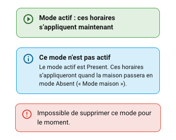</a>

## Variantes utiles

Ces états complètent les mêmes écrans sans ajouter une nouvelle façon de programmer.

### Vue d’ensemble en thème sombre

<a href="images/guide/s01-dark.png">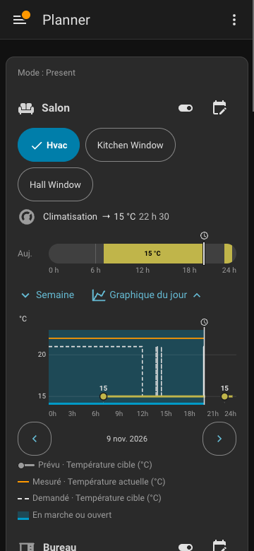</a>

### Cadran en thème sombre

### Formulaire d’horaire en thème sombre

### Graphique en thème sombre

### Carte sans programme

### Programme en pause

### Indicateur de suspension

### Horaires en lecture seule

### Validation d’un nouveau programme incomplet

[Retour au guide pas à pas](GUIDE.fr.md)
